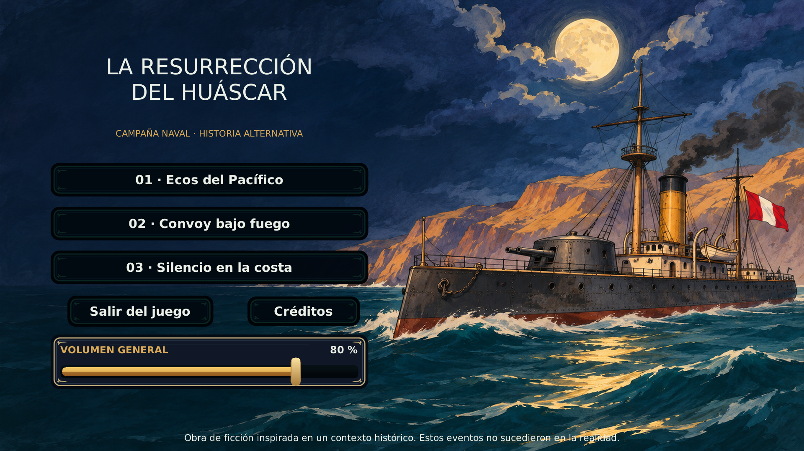

# La Resurrección del Huáscar (LRH)

Videojuego naval 2D de historia alternativa, desarrollado como proyecto de **Tecnología de Objetos (1703240), Universidad Nacional de San Agustín de Arequipa (UNSA), periodo 2026-B**. La ficción no representa acontecimientos históricos reales.

[](https://github.com/frix241/La-Resurreccion-del-Huascar/actions/workflows/ci.yml)

[Tablero Kanban](https://github.com/users/frix241/projects/2) · [Issues](https://github.com/frix241/La-Resurreccion-del-Huascar/issues) · [Guías por desarrollador](docs/GUIA_COMMITS.md) · [Contribuir](CONTRIBUTING.md)



## Abrir el proyecto

1. Instala Unity Editor **6000.6.8f1**, versión de `ProjectSettings/ProjectVersion.txt`.
2. Añade la raíz del proyecto desde Unity Hub y espera a que termine la importación.
3. Abre `Assets/_LRH/Scenes/Main.unity` y pulsa Play.
4. Valida el cambio con los casos del issue. Para compilar Linux instala el módulo correspondiente y selecciona Linux Standalone con `Main.unity` como escena de inicio.

El proyecto incluye tres misiones: interceptar una patrullera, escoltar un convoy y neutralizar baterías costeras. El código del núcleo dispone de 33 comprobaciones .NET; el entorno de desarrollo registró 23/23 PlayMode en la revisión del 7 de noviembre. CI publica su propio resultado para cada PR. Los artefactos y capturas locales se distribuyen fuera de Git.

## Controles previstos para la prueba en Play

| Acción | Control |
|---|---|
| Avanzar / retroceder | **W / S** |
| Girar el casco | **A / D** |
| Apuntar | **Mouse** |
| Disparar | **Clic izquierdo** |
| Pausa / reanudar | **Escape** |

Los controles y la secuencia de combate se validaron en Unity 6000.6.8f1 durante la revisión del 7 de noviembre de 2026. Consulta `docs/04_pruebas.md` para el alcance de cada comprobación.

## Comprobaciones independientes del Editor

Se necesita **.NET SDK 10** para el proyecto de consola incluido. Desde la raíz del proyecto:

```bash
dotnet run --project Tests/CoreChecks/CoreChecks.csproj
```

Resultado actual: **33/33 comprobaciones .NET** con SDK **10.0.114**. Unity Editor **6000.6.8f1** compiló la build Linux y pasó **23/23 pruebas PlayMode**. Las capturas finales están en `Build/Artifacts/retro-captures/`; los artefactos de Build se excluyen de los commits. Consulta [plan de pruebas y alcance](docs/04_pruebas.md).

El workflow [CI](.github/workflows/ci.yml) ejecuta las comprobaciones .NET al hacer push o abrir un pull request hacia `master` o `develop`. Las pruebas PlayMode y la build de Unity se ejecutan localmente; requieren el Editor instalado.

## Organización del proyecto

- `Assets/_LRH/Scripts/Core/`: reglas C# independientes de Unity (`Health`, combate, misiones, `Progress`, `ProgressStore`, informe asíncrono, registro genérico).
- `Assets/_LRH/Scripts/Runtime/`: código Unity de juego: `GameRoot`, `ShipActor`, `ProjectilePool`, `GameUi`, `InputAdapter`, `ActorFactory`, `OpenSea`, `TerrainMap`, `ProgressRepository`, `Visuals` y `SoundFx`.
- `Assets/_LRH/Resources/Configs/*.json`: balance de barcos/baterías leído por `ShipConfig.Load` (`ActorFactory.cs`) mediante `Resources.Load<TextAsset>`; **no son ScriptableObjects**.
- `Assets/_LRH/Scenes/Main.unity`: única escena de inicio versionada; `GameRoot` construye el menú y los niveles por código al iniciar.
- `Assets/_LRH/Art/RetroSource/` contiene las hojas fuente; `Assets/_LRH/Resources/Retro/` contiene los sprites, fondos, texturas y paneles usados por el juego. El generador está en `Tools/build_retro_art.py`.
- La presentación funciona a 1920 × 1080 con filtrado bilinear. La documentación de la dirección visual está en [ARTE_ILUSTRADO.md](docs/ARTE_ILUSTRADO.md).
- `Assets/_LRH/Scripts/Runtime/CartographyVisuals.cs`: carta náutica procedural original del litoral peruano, usada en la preview de misión y como base del minimapa táctico.
- `Assets/_LRH/Scripts/Runtime/OceanVisuals.cs`: fondo oceánico procedural con gradiente de profundidad, bandas de oleaje, bruma luminosa y reflejos, usado solo como capa visual del combate.
- `Assets/_LRH/Scripts/Runtime/UiVisuals.cs` y `UiTheme.cs`: marcos y botones de nueve sectores, con estados y tipografía comunes.
- `GameUi` mantiene la preview antes de iniciar cada misión y muestra el minimapa durante el combate; sus marcadores son de solo lectura y no modifican combate, progreso, IA ni controles.
- Las naves e islas reciben capas visuales separadas de sombra, espuma y estela para mejorar volumen y lectura de movimiento sin alterar colliders, física ni reglas.
- La dirección global se documenta en `docs/research_visual_direction.md`: carta naval 2D moderna, cámara ortográfica, planos de UI separados, escala responsive y luces de evento con propósito.
- `Tests/CoreChecks/`: 33 comprobaciones ejecutables .NET, también en GitHub Actions. `Assets/_LRH/Tests/EditMode/` y `Assets/_LRH/Tests/PlayMode/` contienen las pruebas de Unity; en la última ejecución pasaron 23/23 PlayMode.

Los PlayMode inyectan `MemoryRepository` mediante `GameRoot.ConfigureRepository` antes de `Awake`, en un `GameObject` inactivo, sin escribir progreso real. `UnitySetUp`/`UnityTearDown` limpian entre casos.

## Documentación y equipo

- [Plan maestro original aportado](docs/PLAN_MAESTRO_ORIGINAL.md) (**especificación/propuesta, no evidencia de implementación**) · [Requisitos y alcance](docs/01_requisitos.md) · [Arquitectura](docs/02_arquitectura.md) · [POO y patrones](docs/03_patrones_y_poo.md) · [Pruebas](docs/04_pruebas.md).
- [Informe del primer avance](docs/05_avance_50.md) · [Informe final](docs/06_avance_final.md): borradores académicos con espacios para evidencia **real**, no entregas verificadas.
- [Cómo contribuir](CONTRIBUTING.md) · [Guía gradual de GitHub y commits](docs/GUIA_COMMITS.md) · [Créditos de recursos](docs/creditos_assets.md).

| Desarrollo | Identificador proporcionado |
|---|---|
| Mauro | MauroSullcaMamani |
| Sergio | SrEstrada |
| Christian | ChristianAlexYana |
| Albert | frix241 |

La aceptación de Unity/C# frente al énfasis del sílabo en C++/Qt/CMake, así como la fecha y la rúbrica de entrega, **deben confirmarse con la docente**. Las cuentas del equipo están vinculadas en los issues y en el tablero del proyecto.

La pantalla de créditos incluye los cuatro identificadores proporcionados por el equipo, sin correos electrónicos.

**Aviso histórico:** obra de ficción inspirada en un contexto histórico. Los eventos y enfrentamientos del juego no son acontecimientos históricos reales.

## Arte y mapa

La presentación activa es ilustración 2D pintada con contornos entintados, salida a **1920×1080**, UI y tipografía comunes. El mapa utiliza celdas texturizadas y objetos con colisiones; el minimapa se deriva del mismo mapa guardado. En Unity, **LRH > Editor de terreno** permite editarlo.

- [Arte actual y validación](docs/ARTE_ILUSTRADO.md)
- [Editor de terreno y límites](docs/TERRENO_MODULAR.md)
- [HUD y objetivos](docs/HUD_Y_LIMITES.md)
- [Audio y contactos entre barcos](docs/AUDIO_Y_CONTACTOS.md)

Los documentos de versiones anteriores se conservan como historial. Sus rutas de builds corresponden al entorno de desarrollo y no forman parte del árbol Git.

## Estado de integración

La importación fuente está en el [PR #5](https://github.com/frix241/La-Resurreccion-del-Huascar/pull/5). Tras su aprobación e integración, el equipo abre las ramas de las guías desde `master`. [Reglas del repo y evidencia](docs/REPOSITORIO.md).
