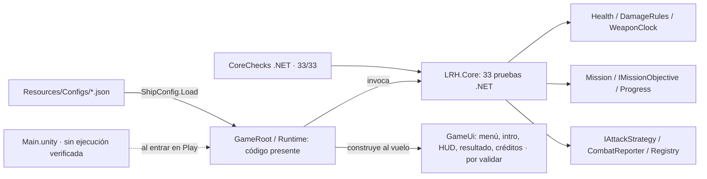
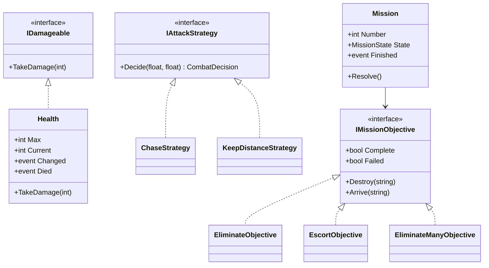
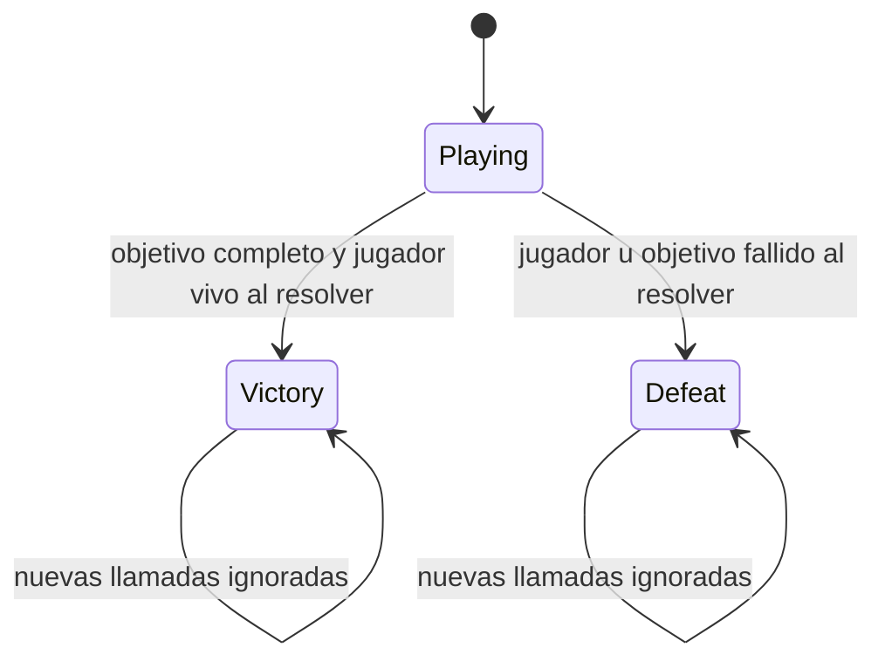

# Arquitectura y contratos — LRH

**Estado:** descripción de archivos C# existentes, **no** certificación de compilación/ejecución Unity. El [plan maestro original](PLAN_MAESTRO_ORIGINAL.md) dibuja `Domain/Application/Infrastructure/Presentation` como arquitectura objetivo; el repositorio implementa reglas puras en `Assets/_LRH/Scripts/Core/` (`LRH.Core`) y adaptación/presentación en `Assets/_LRH/Scripts/Runtime/` (`LRH.Runtime`). El núcleo obtuvo 33/33 casos .NET en una reproducción aislada anterior y en una nueva ejecución sobre el árbol actual comunicada por el usuario (Linux, SDK 10.0.114, 2026-11-06; sin log archivado; registros separados en [pruebas](04_pruebas.md)). Runtime y tests Unity requieren Editor.

## Separación actual y frontera futura

| Zona | Archivos / responsabilidad | Dependencia / nivel de prueba |
|---|---|---|
| Núcleo C# existente | `Health.cs`, `Combat.cs`, `Mission.cs`, `Progress.cs` (desbloqueo/volumen/JSON), `ProgressStore.cs` (archivo/backup), `CombatReport.cs`, `Registry.cs` | `LRH.Core` no importa `UnityEngine`; 33/33 `CoreChecks` .NET en reproducción aislada anterior y ejecución actual comunicada |
| Integración Unity escrita | `GameRoot.cs` (menú/niveles 1–3 creados en ejecución), `ShipActor.cs`, `ProjectilePool.cs`, `GameUi.cs` (introducción/créditos/indicadores), `InputAdapter.cs`, `ActorFactory.cs`, `ProgressRepository.cs`, `Visuals.cs`, `SoundFx.cs` (audio procedural) | Código `LRH.Runtime` inspeccionable; **no** ejecutado en Editor aquí |
| Balance y sprites | `Resources/Configs/{huascar,patrol,gunboat,convoy,battery}.json`; PNG derivados en `Resources/Sprites/`; SVG originales en `Art/SVG/` | `ShipConfig.Load` lee `TextAsset` JSON con `Resources.Load`; **no** se usan ScriptableObjects; importación no verificada |
| Escena / tests Unity | `Assets/_LRH/Scenes/Main.unity`; `Assets/_LRH/Tests/EditMode/CoreTests.cs` y `Assets/_LRH/Tests/PlayMode/MissionPlayTests.cs` (8 UnityTest: movimiento con input falso, impacto único, derrota mediante `Receive`, victoria con guardado en memoria y desbloqueo de misión 2, pausa/reanudar, reintento tras derrota, retorno al menú desde pausa y reinicio, y misión bloqueada) | Única escena versionada; archivos de pruebas presentes, **no ejecutados**; victoria manual pendiente |

**Regla de dependencia:** el núcleo decide si el daño es válido, cuándo puede disparar el reloj, qué objetivo termina y qué misión se desbloquea; el código Unity de Runtime gestiona coordenadas, input, colisiones, render, UI y ciclo de vida. Su funcionamiento aún no se ha comprobado en Unity. No llamar `Transform` ni `GameObject` desde `Task.Run`. Los SVG son los originales y los PNG son derivados para los sprites; confirmar autores en [créditos](creditos_assets.md).

## Contratos disponibles que deben respetarse al integrar

| Contrato real | Entrada/salida | Responsabilidad y caso límite |
|---|---|---|
| `IDamageable.TakeDamage(int)`; `Health(int max)` | `Health : IDamageable`; vida entera; eventos `Changed(current,max)` y `Died` | T33 comprueba despacho por interfaz; `max > 0`, daño negativo rechazado, vida entre 0 y máximo, muerte única; `ShipActor.Receive` usa el contrato en código no ejecutado en Unity |
| `DamageRules.CanHit(Faction,Faction)` | Booleano | Rechaza mismo bando, neutrales y fuego entre Player/Ally; comprobar de nuevo tras colisión Unity |
| `IAttackStrategy.Decide(distance,range)` | `CombatDecision` (`Throttle`,`Fire`) | `ChaseStrategy` y `KeepDistanceStrategy` deciden sin tocar la escena |
| `WeaponClock.TryFire(now)` | Booleano | Impide disparo antes de siguiente instante; no crea proyectil por sí mismo |
| `IMissionObjective.Destroy/Arrive` | `Complete`, `Failed` | `EliminateObjective`, `EscortObjective`, `EliminateManyObjective` reaccionan a IDs; el puente traduce eventos de escena |
| `Mission.Resolve()` | `MissionState`, `FailureReason`; evento `Finished` | Derrota del jugador prioritaria ante pérdida simultánea del convoy; T31–T32 .NET verifican causa; ciclo Unity no comprobado |
| `Progress.Complete/CanPlay/SetVolume/ToJson/FromJson` | Progreso/desbloqueo/volumen/JSON | El modelo trabaja en memoria; T25–T26 prueban volumen/validación |
| `ProgressStore.Load/Save` | Archivo JSON real + copia `.corrupt`/`.bak` | T21–T24/T30 prueban ausencia, corrupción, reinicio, backup y JSON válido formateado en directorios temporales .NET |
| `GameRoot.ConfigureRepository(IProgressRepository)` | Inyección antes de `Awake` en un `GameObject` inactivo | Rechaza `null` y configuración tras inicializar UI; los tests inyectan `MemoryRepository`, sin escribir progreso real |
| `JsonProgressRepository` | `IProgressRepository`; usa `Application.persistentDataPath` | Adaptador de Unity presente; lectura/guardado en Editor aún no verificados |
| `ShipConfig.Load(name)` | JSON en `Resources/Configs` | Balance por `TextAsset` y `JsonUtility`; **no** ScriptableObject; carga real no verificada |
| `CombatReporter.AnalyzeAsync(events,token)` | `Task<CombatReport>` | Copia array antes de `Task.Run`, calcula daño/destrucciones y fuente con más impactos; T18–T19/T27–T29 .NET, vista Unity no comprobada |
| `Registry<T>` | Registro por ID `string`, consulta y eliminación | Genérico; `GameRoot` usa `Registry<ShipActor>` para IDs activos y evita doble notificación al destruir; T20 solo comprueba la estructura con `Health` |

## Modelado de clases comprobables

`Health` **sí implementa** el contrato `IDamageable` con `TakeDamage(int)`; no confundirlo con el `DamageInfo` conceptual del plan maestro. `ChaseStrategy` no se llama `ChaseAndFireStrategy`; **no** dibujar una jerarquía `NavalUnit` o una clase `Actors.cs` como existente. `ShipActor` compone `Health`, `WeaponClock` y `IAttackStrategy`; `Receive` consume `IDamageable` en código Runtime, pendiente de comprobar en Editor.

## Ciclo de una misión (núcleo y unión pendiente)

Menú y pausa están codificados en `GameRoot`/`GameUi`, pero **no** son miembros de `MissionState` (se resuelven mediante `mission == null` e `IsPaused`). `GameRoot.LateUpdate` llama a `Resolve()`. Para un frame con múltiples impactos, registrar todos los hechos antes de resolver; de lo contrario la prioridad de derrota puede cambiar por el orden de callbacks. `GameUi` se suscribe y desuscribe a eventos de salud en el código; verificar su ciclo de vida con Unity.

## Decisiones de extensión y riesgos

1. `IInputSource`/`UnityInputAdapter` convierten W/S, A/D, mouse y clic a `ShipCommand`; `ShipActor.Spawn` acepta `IInputSource` opcional (el test PlayMode `InjectedInput_MovesShipForward` inyecta una implementación falsa), y `GameRoot` lee Escape. Hay fallback compile-time: `ENABLE_INPUT_SYSTEM` usa `Keyboard.current`/`Mouse.current`/`InputSystemUIInputModule`, y sin símbolo se usa entrada legacy/`StandaloneInputModule`. Para demostrar Input System debe seleccionarse **Input System Package (New)** o **Both** en Player Settings, reiniciar y versionar `ProjectSettings/ProjectSettings.asset` y `Packages/packages-lock.json` cuando existan. **Adapter está en código**, pero falta probarlo en Unity.
2. `EnemyFactory` tiene un método `Create` redefinido por `PatrolFactory`/`GunboatFactory` en `ActorFactory.cs`: implementación codificada de Factory Method, sin ejecución acreditada.
3. El guardado separa `Progress` de `ProgressStore` y `JsonProgressRepository`; sin inyección, `Awake` usa `Application.persistentDataPath`. Los PlayMode configuran `MemoryRepository` antes de activar el objeto y comprueban guardado único/desbloqueo en memoria, no persistencia real. `UnitySetUp`/`UnityTearDown` limpian entre casos (directores/arena, tiempo y volumen). El IO temporal está probado en .NET, pero faltan compilación/ejecución Unity y pruebas visuales/manuales de guardado real y slider.
4. `GameRoot.ShowReportAsync` incluye comprobación de instancia/token/misión tras `await` y cancelación al salir; las pruebas .NET no demuestran su ejecución segura en Editor.
5. `GameUi` escucha `Health.Changed` también para los enemigos y limpia sus listeners al cambiar pantalla; `SoundFx` genera tonos de disparo/impacto en memoria y `AudioListener.volume` toma el valor de `Progress`. Audio/HUD/narrativa deben observarse en Play; créditos DEV-1…DEV-4 deben sustituirse por identidades reales.
6. La división de archivos y contratos requiere revisión conjunta antes de asignar tareas. Véanse [POO y patrones](03_patrones_y_poo.md) y [guía de contribución](../CONTRIBUTING.md).
