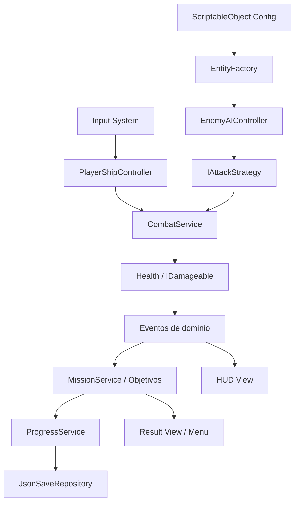
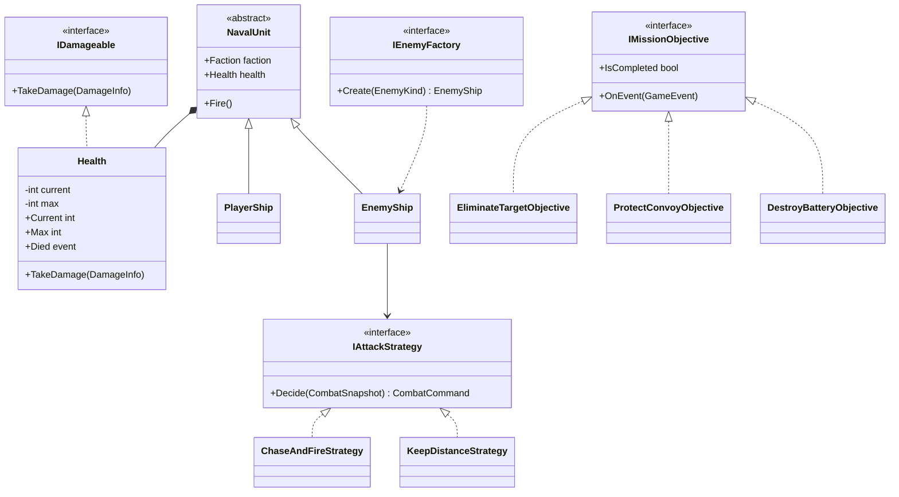
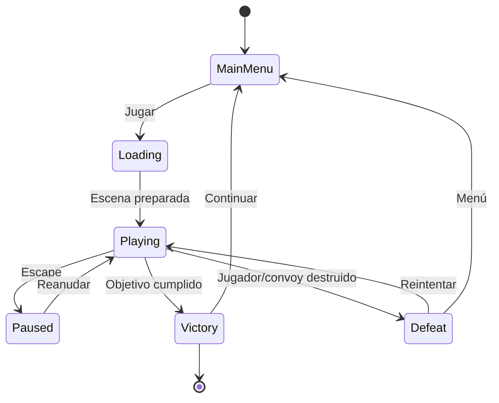
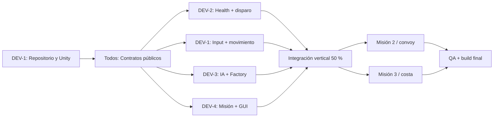
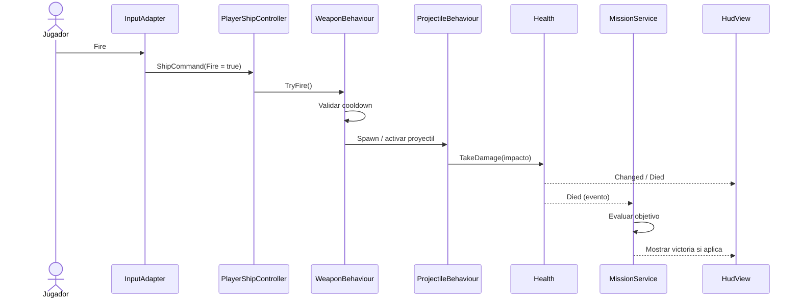

# LA RESURRECCIÓN DEL HUÁSCAR (LRH)
## Plan maestro de desarrollo, avance del 50 %, arquitectura POO, aplicación del sílabo y guía de trabajo de cuatro desarrolladores

> **Universidad Nacional de San Agustín de Arequipa (UNSA)**  
> **Vicerrectorado Académico**  
> **Facultad de Ingeniería de Producción y Servicios**  
> **Departamento Académico de Ingeniería de Sistemas e Informática**  
> **Escuela Profesional:** Ingeniería de Sistemas  
> **Asignatura:** Tecnología de Objetos — código 1703240 — VI semestre  
> **Periodo académico:** 2026-B  
> **Equipo:** 4 desarrolladores (reemplazar DEV-1 a DEV-4 con nombres reales)  
> **Versión del documento:** 1.0 — 6 de noviembre de 2026  
> **Estado:** plan de ejecución; las tareas marcadas como pendientes **no se consideran implementadas**.

**Proyecto:** *La Resurrección del Huáscar: Una Historia Alternativa Después de la Guerra del Pacífico*  
**Sigla:** `LRH`  
**Repositorio sugerido:** `la-resurreccion-del-huascar`  
**Tipo:** videojuego 2D de acción naval, vista superior, un jugador, PC.  
**Motor/lenguaje:** Unity + C#.  
**Entregas:** primer avance funcional y documentado equivalente al 50 % del alcance; entrega final con el 100 % del alcance aprobado.

---

# 0. Cómo usar este documento

Este archivo es simultáneamente:

1. Una **propuesta académica** de lo que se va a demostrar en Tecnología de Objetos.
2. Una **especificación funcional y técnica** del videojuego.
3. Una **lista de verificación del avance del 50 %**, con evidencias comprobables.
4. Un **plan de colaboración de cuatro desarrolladores**, con responsabilidades, ramas, issues, pull requests y commits sugeridos.
5. Una **hoja de ruta de cierre**, de la mitad funcional hasta la entrega final.

**Importante:** el profesor debe confirmar la rúbrica y la fecha del primer avance; aquí se propone una interpretación técnicamente defendible del «50 %». No se afirma que sea la rúbrica oficial. Las características, cifras de balance y fechas de sprints son decisiones propuestas del equipo y pueden ajustarse.

**Regla de oro:** se prioriza un juego que funciona, se puede explicar y se puede probar sobre un juego enorme lleno de conceptos incorporados artificialmente. Los temas específicos de C++ se compararán con C# y se explicará por qué no se implementan literalmente en Unity.

---

# 1. Contexto del sílabo y criterios del proyecto

## 1.1. Datos del curso

| Dato | Información provista en el sílabo |
|---|---|
| Universidad | Universidad Nacional de San Agustín de Arequipa |
| Asignatura | Tecnología de Objetos |
| Código | 1703240 |
| Periodo | 2026-B |
| Escuela | Ingeniería de Sistemas |
| Semestre | VI |
| Duración consignada | 17 semanas |
| Créditos | 4 |
| Docente consignada en cronograma | M. Molina |
| Otros docentes consignados | Roni Guillermo Apaza Aceituno; Diego Alonso Iquira Becerra |
| Entorno enseñado en primera unidad | C++, Qt, CMake, Git |
| Proyecto elegido por el grupo | C# y Unity, a validar con la docente si exige C++/Qt |

**Advertencia académica:** el sílabo enfatiza C++/Qt/CMake en la primera unidad y después programación genérica, multithreading, patrones GoF y MVC. El requisito comunicado por el grupo dice «utilizar un lenguaje orientado a objetos», por lo que **C# resulta adecuado a nivel de paradigmas**, pero la **aceptación de Unity/C# debe ratificarse con la docente** si la consigna oficial exige explícitamente C++ o Qt. No corresponde afirmar que C# cubre automáticamente los detalles específicos de C++.

## 1.2. Aprendizajes que deben verse en el producto

- Diseño con **clases, objetos, abstracción, encapsulación, herencia y polimorfismo**.
- **Composición**, interfaces y principios **SOLID** y **GRASP**, con cohesión alta y acoplamiento bajo.
- **Programación genérica** y colecciones; manejo de errores; persistencia.
- **Patrones de diseño** creacionales, estructurales y de comportamiento; **MVC adaptado a Unity**.
- **GUI** funcional y comunicación entre componentes por eventos.
- **Pruebas unitarias** y pruebas de integración, refactorización y uso de Git.
- **Concurrencia / multithreading** demostrable, pero sin tocar la API de Unity desde threads secundarios.
- Documentación técnica, diagramas UML, trazabilidad entre requisito, clase, prueba y evidencia.

## 1.3. Hitos del sílabo que dan contexto

Según el cronograma facilitado: programación genérica/persistencia en semana 8, multithreading en semana 9, patrones GoF y MVC en semana 11, exposiciones en semana 12, presentación del trabajo final en semana 13 y tercera evaluación parcial fechada el **7 de diciembre de 2026**. Estas referencias **no establecen por sí mismas la fecha concreta del avance del 50 %**: validar con el aula virtual y la docente. El documento recomienda reservar al menos una sesión de integración y otra de ensayo antes de cada entrega.

---

# 2. Identidad, idea y propósito del videojuego

## 2.1. Nombre

**La Resurrección del Huáscar: Una Historia Alternativa Después de la Guerra del Pacífico.**

## 2.2. Descripción resumida

Videojuego de acción naval **2D top-down**, ambientado en una **historia alternativa ficticia** posterior a la Guerra del Pacífico. El jugador controla el monitor Huáscar, navega por escenarios costeros, maniobra, apunta y dispara contra embarcaciones enemigas y posiciones de artillería. La campaña contiene tres misiones: interceptación, escolta y ataque costero. La historia se presentará claramente como ficción; no se representará el retorno del Huáscar como un hecho histórico real.

## 2.3. Planteamiento del problema académico

Un videojuego puede servir como sistema observable para aplicar y evaluar arquitectura orientada a objetos: debe administrar entidades con atributos y comportamientos, separar responsabilidades, responder a eventos, manejar estado, persistir progreso, mostrar GUI y verificar reglas mediante pruebas. El desafío no es únicamente mover sprites, sino **construir un software mantenible y extensible** con técnicas vistas en el curso.

## 2.4. Objetivo general

**Diseñar, implementar y validar un videojuego de combate naval 2D en Unity/C# que integre los conceptos fundamentales y avanzados de Tecnología de Objetos mediante una arquitectura modular, patrones de diseño justificables, pruebas automatizadas, GUI y un ejemplo seguro de concurrencia.**

## 2.5. Objetivos específicos

1. Diseñar un modelo de dominio con entidades navales, armas, daño, misiones y objetivos, usando interfaces, herencia y composición.
2. Implementar controles del Huáscar, combate 2D, colisiones y destrucción.
3. Crear dos enemigos navales con estrategias diferenciadas.
4. Construir tres misiones conectadas narrativamente y con reglas de victoria/derrota distintas.
5. Incorporar artillería costera y convoy aliado.
6. Crear menú, HUD, pantallas de resultados y guardado de progreso.
7. Demostrar al menos un patrón creacional, uno estructural y uno de comportamiento, y una organización de interfaz estilo MVC/MVP.
8. Aplicar genéricos, colecciones, excepciones y pruebas automatizadas.
9. Demostrar multithreading en una tarea aislada de cálculo sin manipular Unity fuera del hilo principal.
10. Coordinar el desarrollo en GitHub con historial trazable y participación verificable de cuatro integrantes.

## 2.6. Público y plataforma

- Plataforma: PC (Windows x64 si el equipo cuenta con el módulo de compilación correspondiente).
- Modo: un jugador, sin conexión.
- Controles: teclado para navegación; mouse para apuntado; botón izquierdo o tecla asignada para disparo; Escape para pausa.
- Resolución de referencia: 16:9; UI adaptable a distintos tamaños de ventana.
- Estilo visual: sprites 2D simplificados y coherentes; se prefieren recursos propios o con licencia válida.

---

# 3. Alcance: mínimo viable, 50 % y 100 %

## 3.1. Alcance aprobado propuesto para el producto final

**Incluido:**

- Un único buque controlable: Huáscar.
- Movimiento 2D, giro, apuntado y disparo.
- Dos tipos de enemigos navales (rápido/frágil y pesado/resistente).
- Inteligencia artificial básica de acercamiento, distancia de combate y disparo.
- Sistema común de vida, daño, impactos, destrucción y efectos visuales mínimos.
- Tres misiones: interceptación, escolta y ataque a artillería costera.
- Convoy aliado en misión 2; posiciones de costa/isla en misión 3.
- Menú, HUD, pausa, victoria, derrota, selector/desbloqueo de misiones.
- Persistencia local de progreso y ajustes simples.
- Código organizado por capas, aplicación justificada de POO, SOLID, GRASP, genéricos, patrones y concurrencia.
- Pruebas de reglas críticas y una build ejecutable.

**Excluido de manera explícita:**

- Multijugador en línea, sockets en el juego principal y servidores remotos.
- Mundo abierto, editor de niveles, física naval realista, simulación histórica exacta.
- Soldados, combate terrestre, navegación tridimensional, economía o inventarios complejos.
- Redes neuronales, pathfinding avanzado o comportamiento táctico sofisticado.
- Arquitectura de microservicios o bases de datos remotas.

## 3.2. Definición operacional del primer avance (50 %)

No se interpreta como «tener el 50 % del código escrito». Se interpreta como **un corte vertical jugable** y una base técnica demostrable:

**Debe funcionar de punta a punta:** abrir el menú → iniciar Misión 1 → controlar el Huáscar → apuntar/disparar → un enemigo persigue/ataca → el daño disminuye la vida → el enemigo o el jugador se destruye → se muestra victoria/derrota → se puede volver al menú. El resultado se registra en un progreso local simple si el desbloqueo inicial está previsto en el primer corte.

**Debe poder explicarse:** desde una acción de teclado hasta el cambio de estado en el modelo, un evento y la actualización del HUD, indicando clases, interfaces y patrones concretos.

**Debe poder verificarse:** escenas Unity, repositorio GitHub, proyecto reproducible, diagramas, documentación, pruebas y ejecutable o instrucciones de ejecución del Editor.

## 3.3. Rúbrica interna propuesta: exactamente 50 puntos al primer avance

| Bloque del producto total | Puntos de 100 | Evidencia exigida al primer avance |
|---|---:|---|
| Análisis, requisitos, arquitectura y UML | 10 | Documento, diagramas, ADR de stack, backlog |
| Base POO, SOLID, genéricos y patrones iniciales | 10 | Clases e interfaces, tests, código revisado |
| Mecánica central: movimiento, disparo, colisión, daño y 1 enemigo | 20 | Demostración jugable de Misión 1 |
| GUI inicial y navegación | 5 | Menú, HUD, victoria y derrota |
| Pruebas, GitHub, integración y primer build | 5 | Pruebas mínimas, PR, README, build o reproducción |
| **Subtotal verificable para el avance** | **50** | **Primer corte vertical** |
| Segundo enemigo, estrategia adicional, balance | 10 | Entrega final |
| Misión 2 con convoy y su IA | 10 | Entrega final |
| Misión 3 con artillería costera | 10 | Entrega final |
| Progreso completo, menús ampliados, refinamiento visual/sonoro | 10 | Entrega final |
| Concurrencia demostrable, pruebas ampliadas, optimización y memoria | 10 | Entrega final |
| **TOTAL** | **100** | **Sistema terminado** |

> Esta ponderación es **interna y propuesta**, no una nota oficial. Si la docente exige multithreading desde el primer avance, mover su microdemostración (apartado 13) al primer corte sin sacrificar el vertical slice.

## 3.4. Criterios de aceptación innegociables del 50 %

- [ ] El repositorio abre en la **misma versión de Unity** para los cuatro integrantes.
- [ ] El proyecto compila sin errores ni scripts faltantes.
- [ ] Existe un menú principal con acción *Jugar*.
- [ ] El Huáscar se desplaza y rota; no atraviesa obstáculos sólidos definidos.
- [ ] El cañón apunta de modo reproducible y dispara con cadencia limitada.
- [ ] Se instancian/reciclan proyectiles, se detectan impactos y se aplica daño una sola vez por impacto.
- [ ] Un enemigo naval sigue una conducta básica, puede atacar y puede morir.
- [ ] La Misión 1 tiene condiciones de victoria y derrota comprobables.
- [ ] El HUD muestra vida y objetivo; hay pantallas de victoria/derrota.
- [ ] El modelo separa lógica del dominio de `MonoBehaviour` donde sea viable.
- [ ] Existe al menos un ejemplo real de interfaz/polimorfismo, una Factory, una Strategy y Observer mediante eventos.
- [ ] Hay por lo menos 6 pruebas automáticas relevantes y reporte/capturas de ejecución.
- [ ] Los cuatro desarrolladores tienen contribuciones reales documentadas y PR revisados.
- [ ] README con controles, instalación, arquitectura, integrantes y estado del 50 %.
- [ ] Una build puede ejecutarse en otro PC compatible o se documenta una reproducción controlada en el Editor.

## 3.5. Qué NO hace falta terminar para mostrar el 50 %

No es imprescindible tener las tres misiones, arte definitivo, efectos de sonido completos, IA avanzada, guardado elaborado ni multithreading de producción. **Sí** conviene tener interfaces/estructuras diseñadas para extender esas funciones sin rehacer el núcleo.

---

# 4. Requerimientos funcionales y no funcionales

## 4.1. Funcionales (RF)

| ID | Requisito | Prioridad | Avance previsto | Validación |
|---|---|---|---|---|
| RF-01 | Menú principal: iniciar, salir | Alta | 50 % | UI manual |
| RF-02 | Control de traslación y rotación del Huáscar | Alta | 50 % | PlayMode/manual |
| RF-03 | Apuntado y disparo con cooldown | Alta | 50 % | EditMode/PlayMode |
| RF-04 | Proyectiles con velocidad, vida útil, equipo y daño | Alta | 50 % | Test + escena |
| RF-05 | Colisión, vida, impacto y destrucción | Alta | 50 % | Test + escena |
| RF-06 | Enemigo tipo A con IA básica | Alta | 50 % | PlayMode |
| RF-07 | Misión 1: interceptar buque | Alta | 50 % | E2E manual |
| RF-08 | HUD vida y objetivo | Alta | 50 % | GUI |
| RF-09 | Estados victoria/derrota/reinicio | Alta | 50 % | Pruebas |
| RF-10 | Enemigo tipo B, distinto en atributos y Strategy | Alta | Final | Test + escena |
| RF-11 | Misión 2: proteger convoy | Alta | Final | E2E |
| RF-12 | Misión 3: destruir artillería costera | Alta | Final | E2E |
| RF-13 | Desbloqueo secuencial de misiones | Alta | Final; esqueleto al 50 % | Test |
| RF-14 | Persistencia local de progreso | Media-alta | Final; simple si posible al 50 % | Save/load |
| RF-15 | Pausa, reanudar y volver al menú | Media | Final | GUI manual |
| RF-16 | Indicadores de daño/vida de enemigos | Media | Final | GUI manual |
| RF-17 | Narrativa breve antes/después de cada misión | Media | Final | Manual |
| RF-18 | Análisis de amenazas asíncrono sobre datos inmutables | Media/académica | Final o 50 % si requerido | Test de concurrencia |
| RF-19 | Registro de eventos de misión con Observer | Alta | 50 % | Test |
| RF-20 | Creación de tipos de naves mediante Factory | Alta | 50 % base | Test |

## 4.2. No funcionales (RNF)

| ID | Requisito | Meta propuesta | Evidencia |
|---|---|---|---|
| RNF-01 | Mantenibilidad | Archivos por responsabilidad, sin `GameManager` monolítico | Revisión de PR |
| RNF-02 | Modificabilidad | Crear tipo de enemigo con nuevos datos/Strategy, sin modificar sistema de daño | Demo/código |
| RNF-03 | Testabilidad | Reglas de salud, objetivos y factorías probadas sin escena | Test Runner |
| RNF-04 | Rendimiento | Referencia 60 FPS en el PC de laboratorio; registrar equipo y resultados | Profiling básico |
| RNF-05 | Portabilidad | Un proyecto Unity reproducible con `manifest.json` y `ProjectVersion.txt` | Clon limpio |
| RNF-06 | Usabilidad | HUD legible, controles documentados y reintento claro | Ensayo con compañero |
| RNF-07 | Integridad de datos | Progreso válido incluso si no existe archivo o contiene JSON inválido | Test de fallos |
| RNF-08 | Robustez | No disparar ni cargar escenas incorrectamente si se pierde referencia | Logs/test |
| RNF-09 | Trazabilidad | RF ↔ clase ↔ issue ↔ test ↔ commit/PR | Matriz documental |
| RNF-10 | Reproducibilidad | Repositorio sin carpetas generadas por Unity; assets con `.meta` | Git y README |

## 4.3. Historias de usuario principales

- **HU-01:** Como jugador, quiero controlar el Huáscar para evadir ataques y posicionarme.
- **HU-02:** Como jugador, quiero apuntar/disparar para destruir enemigos.
- **HU-03:** Como jugador, quiero ver mi vida y objetivo para tomar decisiones.
- **HU-04:** Como jugador, quiero ver victoria/derrota y reiniciar sin reiniciar la aplicación.
- **HU-05:** Como jugador, quiero escoltar un convoy que pueda sufrir daño.
- **HU-06:** Como jugador, quiero atacar baterías en costa sin que exista combate terrestre.
- **HU-07:** Como jugador, quiero conservar el desbloqueo de misiones después de cerrar el juego.
- **HU-08:** Como docente, quiero reconocer interfaces, patrones, genéricos y pruebas en el código.

---

# 5. Correspondencia EXHAUSTIVA con los temas del sílabo

**Lectura de la columna «cobertura»:** **Implementar** = funcionalidad real y demostrable; **Demostrar/explicar** = ejemplo acotado y documentación; **Comparar** = contenido propio de C++ o de sistemas distribuidos, no traslado literal a Unity.

| Tema del sílabo | Aplicación concreta en LRH | Cobertura | Evidencia recomendada |
|---|---|---|---|
| C++, Qt | El curso los enseña, pero el proyecto selecciona Unity/C# bajo validación docente | Comparar | ADR-001: elección tecnológica |
| CMake y Git | Git sí; Unity gestiona compilación C# sin usar CMake directamente | Implementar/comparar | Repositorio, PR, explicación |
| POO: clases/objetos | `Ship`, `Weapon`, `ProjectileData`, `Mission`, `Health` | Implementar | UML + scripts |
| Encapsulación | Campos privados; propiedades de solo lectura; `TakeDamage()` valida | Implementar | Test de invariantes |
| Abstracción | `IDamageable`, `IAttackStrategy`, `IMissionObjective` | Implementar | Diagrama y tests |
| Herencia | `NavalUnit` abstracta → clases o variantes concretas | Implementar con mesura | UML + ejecución |
| Polimorfismo dinámico | Diferentes estrategias detrás de `IAttackStrategy`; objetivos distintos detrás de `IMissionObjective` | Implementar | Test con dos implementaciones |
| Interfaces/clases abstractas/funciones virtuales | Interfaces C# y métodos `abstract`/`virtual`/`override` | Implementar | Explicación equivalente C++ |
| Cohesión, acoplamiento, modificabilidad, comprobabilidad | Servicios por responsabilidad; inyección por constructor en lógica pura | Implementar | Dependencias acotadas |
| SOLID | SRP, OCP, LSP, ISP, DIP demostrados con casos concretos | Implementar | Matriz de diseño |
| GRASP | Expert, Creator, Controller, Low Coupling, High Cohesion, Indirection, Polymorphism | Implementar | ADR + UML |
| Punteros/punteros inteligentes | C# usa referencias administradas; `null`, ciclo de vida de Unity, `IDisposable` cuando procede; no `unique_ptr` | Comparar | Nota técnica de memoria |
| Constructores/destructores | Constructores en clases C# puras; `Awake/OnEnable/OnDestroy` en componentes Unity; evitar depender de finalizadores | Implementar/comparar | Ciclo de vida explicado |
| STL `memory` | Colecciones .NET, GC y recursos Unity; `Destroy()` no equivale a `delete` | Comparar | Tabla C++/C# |
| Paso por valor/referencia, estáticos | Métodos con valor, `ref`/`out` cuando realmente tiene sentido; utilidades estáticas puras | Demostrar | Test pequeño |
| Inline | JIT/AOT puede decidir inline; evitar prometer control de inline estilo C++ | Comparar | Nota técnica |
| `friend` | No equivalente directo; `internal` y assemblies no son `friend` C++ | Comparar | Nota de accesibilidad |
| `const` | `const`, `readonly` y propiedades de solo lectura en C# | Implementar | `GameRules`/configuración |
| Lambda | Filtrado de amenazas en datos con `Where`, expresiones de callback | Implementar | Código y test |
| Sobrecarga de operadores | `readonly struct` de valor de dominio, p.ej. `DamageAmount`, si añade claridad | Demostrar opcional | Test de operador |
| Covarianza/contravarianza | Interfaces genéricas `out T`/`in T` para fuentes/consumidores de eventos o spawn | Demostrar con mini-ejemplo | Test + explicación |
| Manejo de errores/excepciones | Validación de JSON/cfg; errores de IO; fallback seguro | Implementar | Tests de casos negativos |
| Aserciones y diseño por contratos | Precondición `maxHealth > 0`; invariantes `0 ≤ Current ≤ Max`; postcondición vida disminuye o queda 0 | Implementar | Tests NUnit |
| Testing | EditMode + PlayMode | Implementar | Captura Test Runner |
| Refactoring | Extraer responsabilidades; registrar antes/después en PR | Implementar | Issue y diff |
| Programación genérica/templates | Genéricos C# `Repository<T>`, `Pool<T>`, `IReadOnlyList<T>`; C# genéricos **no son** templates C++ | Implementar/comparar | Código + test |
| Colecciones | `List<T>`, `Dictionary<TKey,TValue>`, `HashSet<T>`, `Queue<T>` | Implementar | Uso justificado |
| Persistencia | JSON de progreso, guardado local | Implementar | Pruebas save/load |
| Metaprogramación y polimorfismo estático | C# proporciona genéricos, constraints, `typeof`, atributos/reflexión moderada; no afirmar equivalencia total con templates C++ | Demostrar/explicar | Mini-prueba o anexo |
| Multithreading básico | `Task.Run`, `CancellationToken`, snapshot inmutable, sincronización correcta | Implementar acotado | Caso de uso medible/test |
| Objetos función | Delegados `Action<T>`, `Func<T>`, lambdas; equivalente conceptual de *callable objects* | Implementar | Observer/Strategy |
| Atomicidad y condiciones de carrera | `lock`, `Interlocked` si hay estado compartido; preferir no compartir estado | Demostrar | Caso de prueba / justificación |
| Patrones GoF creacionales | Factory Method o Simple Factory **identificada correctamente**; opcional Abstract Factory si se justifica | Implementar | Diagrama, test |
| Patrones GoF estructurales | Adapter para encapsular entrada / persistencia, sin lógica del dominio dependiente de Unity | Implementar | Adaptador e interfaz |
| Patrones GoF de comportamiento | Strategy (IA), Observer (eventos); opcional State (estados IA/misión) | Implementar | Diagramas y tests |
| MVC | Modelo puro + Controlador/orquestador + Vista HUD/menú, con adaptadores `MonoBehaviour` | Implementar | Diagrama flujo de eventos |
| Frameworks | Unity como framework/motor; NUnit/Test Framework | Implementar | Manifest y Tests |
| Programación orientada a aspectos | *Cross-cutting concerns* de logging/telemetría aislados en servicios; sin requerir un framework AOP | Demostrar/explicar | ADR |
| Objetos paralelos/distribuidos | Análisis de amenazas en tarea paralela; no convertir el juego en servicio remoto | Implementar/acotar | Diagrama de hilo |
| Sockets e invocación remota | **Fuera del alcance principal** (offline); incluir apartado conceptual de alternativas si lo pide la docente | Comparar | Riesgos y justificación |

## 5.1. Frases que deben saber defender frente a la profesora

- «La **herencia** se usa solo donde existe una relación *es-un*; preferimos **composición** para vida, armas y movimiento». 
- «Las **interfaces** permiten cambiar una estrategia sin modificar al controlador que la utiliza: esto ilustra OCP y DIP».
- «Observer separa lógica de misión y HUD: la muerte de un enemigo publica un evento que distintos observadores consumen».
- «El patrón creacional está centralizado para que los `Instantiate` no aparezcan dispersos en cada enemigo».
- «En multithreading utilizamos **datos simples copiados**, porque la API de `UnityEngine` no debe manipularse desde una tarea de fondo».
- «Los **genéricos de C#** y los **templates de C++** resuelven problemas relacionados de reutilización tipada, pero no son idénticos».
- «No construimos una red ficticia únicamente para marcar una casilla del sílabo: preferimos justificar los límites del alcance».

---

# 6. Stack técnico viable y congelación de versiones

## 6.1. Stack recomendado

| Capa | Herramienta | Decisión |
|---|---|---|
| Motor | **Unity 6.3 LTS** | Versión LTS estable; fijar **exactamente el patch** instalado por los 4 |
| Lenguaje | C# compatible con el editor Unity elegido | No usar funciones de C#/.NET que el Editor no soporte |
| IDE | Visual Studio o JetBrains Rider / VS Code con extensiones compatibles | Elegir y configurar por desarrollador |
| Control de versiones | Git + GitHub | `main`, `develop`, ramas cortas por issue |
| Diseño 2D | Unity 2D, sprites, Tilemap **opcional** | Reducir tiempo de arte |
| Física | `Rigidbody2D` + `Collider2D` | Impactos y límites sólidos |
| Input | **Input System** oficial | Definir acciones `Move`, `Turn`, `Aim`, `Fire`, `Pause` |
| UI | Unity UI (uGUI) + TextMeshPro | Ruta directa para menú, HUD y resultado |
| Datos de balance | `ScriptableObject` | Configuración de naves/armas/enemigos |
| Guardado | JSON local en `Application.persistentDataPath` | Archivo de progreso con versión |
| Tests | Unity Test Framework + NUnit | EditMode para dominio, PlayMode para escenas |
| Diagrama | Mermaid en Markdown, draw.io opcional | Diagramas reproducibles en `docs/` |
| Gestión | GitHub Issues, Milestones y Projects opcional | Reporte de trabajo individual |
| Entrega | Windows build, PDF de diapositivas si se solicita, este Markdown | Compilable y demostrable |

**Nota sobre versión:** Unity identifica un Editor con versión de cuatro componentes (por ejemplo, `6000.3.xf1`); **no inventar un número de patch**. El que se instale queda registrado en `ProjectSettings/ProjectVersion.txt`, y todos deben utilizarlo. No actualizar Unity durante la semana de la entrega.

Documentación de consulta: [Unity 6 releases y soporte](https://unity.com/releases/unity-6/support), [Unity 6.3 LTS](https://unity.com/blog/unity-6-3-lts-is-now-available), [Unity Input System](https://docs.unity3d.com/Packages/com.unity.inputsystem@1.0/manual/index.html) (consultar la versión del paquete instalada), [Unity Test Framework](https://docs.unity3d.com/Manual/com.unity.test-framework.html).

## 6.2. Qué debe quedar versionado

**Sí:** `Assets/`, `Packages/manifest.json`, `Packages/packages-lock.json`, `ProjectSettings/`, `.gitignore`, `.gitattributes` si usan LFS, `README.md`, `docs/`, `.github/`. Mantener archivos `.meta`.

**No:** `Library/`, `Temp/`, `Obj/`, `Logs/`, `UserSettings/`, `Build/`, `Builds/`, archivos `.sln`/`.csproj` generados y secretos. Revisar el `.gitignore` oficial de Unity.

## 6.3. Ajustes de Unity obligatorios al crear el proyecto

1. Crear proyecto **2D Core** y elegir render pipeline solo si se necesita; por defecto basta 2D sin efectos caros.
2. Establecer **Visible Meta Files** y **Asset Serialization: Force Text**.
3. Instalar paquetes necesarios y dejar `manifest.json`/lock versionados.
4. Definir resolución base 1920 × 1080 (Canvas Scaler: *Scale With Screen Size*), verificando otros tamaños.
5. Crear capas (`Player`, `Enemy`, `Ally`, `Projectile`, `Environment`) y matriz de colisiones.
6. Ordenar sorting layers (`Background`, `Coast`, `Ships`, `Projectiles`, `Effects`, `UI`).
7. Fijar escenas en Build Profiles y escribir en el README cómo arrancar.
8. Evitar editar **simultáneamente la misma escena o prefab** en dos ramas.

---

# 7. Diseño del juego y reglas de combate

## 7.1. Jugabilidad base

1. El jugador acelera/retrocede y gira al Huáscar; el comportamiento puede ser arcade (sin física realista).
2. El cañón puede rotar independientemente del casco hacia la posición del mouse.
3. Al disparar, el arma comprueba `cooldown` y crea un proyectil.
4. El proyectil avanza; el sistema de colisiones determina el objetivo válido por equipo/facción.
5. `Health` recibe daño, limita valores a `[0, MaxHealth]`, emite `HealthChanged` y, al llegar a cero, `Died` **una sola vez**.
6. Los enemigos emplean una Strategy para decidir movimiento/ataque.
7. La misión escucha eventos de objetivos y decide victoria/derrota.
8. El HUD observa el estado, sin tener autoridad para cambiar vida ni misión.

## 7.2. Valores de balance inicial (propuesta, no cifras históricas)

| Entidad | Vida | Velocidad | Daño por impacto | Cadencia/nota |
|---|---:|---:|---:|---|
| Huáscar | 100 | 4 unidades/s | 25 | 1 disparo/0,8 s |
| Enemigo A: patrullera | 50 | 3,2 u/s | 10 | disparo cada 1,5 s |
| Enemigo B: cañonera | 100 | 1,8 u/s | 18 | disparo cada 2,2 s |
| Convoy aliado | 120 | 1,4 u/s | 0 | sigue ruta fija |
| Artillería costera | 70 | inmóvil | 15 | disparo cada 2 s |

Se registrarán los valores en `ShipConfig` / `WeaponConfig` (`ScriptableObject`), de modo que **balancear no requiera recompilar clases**. Establecer límite de proyectiles en pantalla y destruir/reciclar los que superen su vida útil.

## 7.3. Dos tipos de enemigo claramente distintos

- **Patrullera (A):** rápida, poca vida, acorta distancia y dispara cuando entra en rango.
- **Cañonera (B):** lenta, más resistencia; mantiene distancia de artillería y dispara con más daño.

Comparten `Health`, `Weapon`, `Targeting` y contrato `IAttackStrategy`, pero utilizan configuraciones y estrategias diferentes. **No** implementar dos scripts copiados cambiando únicamente números si se puede parametrizar una clase y variar la estrategia.

## 7.4. Campaña: tres misiones

| Misión | Título sugerido | Objetivo principal | Condición de derrota | Entidades nuevas |
|---|---|---|---|---|
| 1 | Ecos del Pacífico | Interceptar una patrullera que amenaza una ruta | Huáscar destruido | Huáscar, enemigo A |
| 2 | Convoy bajo fuego | Proteger convoy hasta llegar a punto seguro | Convoy o Huáscar destruido | Convoy, enemigo B |
| 3 | Silencio en la costa | Neutralizar 2–3 baterías de artillería | Huáscar destruido | Isla/costa, torretas |

El número de enemigos, baterías y oleadas debe mantener las misiones en torno a **3–5 minutos** cada una para la demostración; los valores se ajustan después de probar.

## 7.5. Narrativa breve y responsable

**Introducción:** en una línea temporal alternativa, décadas después de la guerra, una antigua figura naval reaparece ante tensiones ficticias en la costa del Pacífico. **Misión 1:** proteger una ruta de suministros. **Misión 2:** defender embarcaciones civiles/aliadas. **Misión 3:** inutilizar baterías que amenazan la navegación. **Cierre:** se evita equiparar esta ficción con hechos históricos. En el menú o créditos incluir: «Obra de ficción inspirada en un contexto histórico. Los eventos y enfrentamientos del juego no son acontecimientos históricos reales».

---

# 8. Arquitectura propuesta: C# limpio + Unity como capa de presentación/adaptación

## 8.1. Regla principal de arquitectura

**Las reglas del juego deben estar, cuando sea posible, en clases C# normales, no dentro de un único `GameManager : MonoBehaviour`.** Unity ejecuta física, entrada, gráficos, escenas y audio. El dominio decide vida, objetivos, daño permitido, estados y resultados.

| Capa | Contiene | Depende de |
|---|---|---|
| `Domain` | `Health`, `DamageInfo`, `MissionObjective`, interfaces, estrategias de reglas | BCL/C#; sin Unity si es viable |
| `Application` | `CombatService`, `MissionService`, `ProgressService`, orquestación | `Domain` + interfaces de puertos |
| `Infrastructure` | `JsonSaveRepository`, adaptadores de input, factories Unity, telemetría | contratos y APIs externas |
| `Presentation` | `ShipController`, `EnemyView`, `HudView`, `MenuView`, componentes de escenas | `Application`/contratos + Unity |

**Pragmatismo:** es aceptable que los `MonoBehaviour` hagan de puente y que algunas coordenadas usen `Vector2`; no convertir el pequeño juego en un framework genérico. Aun así, el modelo `Health`/`MissionObjective` debe probarse sin escena.

## 8.2. Diagrama de componentes



## 8.3. Diagrama de clases conceptual



**Advertencia:** diagrama **conceptual**. `PlayerShip` y `EnemyShip` pueden representarse como *modelos* puros o como componentes de Unity con composición. No afirmar que una subclase de `MonoBehaviour` se construye con `new`: los componentes se crean mediante `AddComponent<T>` o prefabs instanciados por Unity.

## 8.4. Clases e interfaces concretas a planificar

| Clase/interfaz | Responsabilidad única | Responsable principal |
|---|---|---|
| `Health` | Vida, daño, límites y evento de muerte | DEV-2 |
| `DamageInfo` | Datos del impacto (cantidad, emisor, facción) | DEV-2 |
| `IDamageable` | Contrato de entidad dañable | DEV-2 |
| `WeaponModel` | Reglas de cadencia/daño, sin efectos visuales | DEV-2 |
| `WeaponBehaviour` | Posicionamiento y disparo visual/físico | DEV-2 |
| `ProjectileBehaviour` | Avanzar, detectar objetivo y aplicar daño | DEV-2 |
| `IProjectilePool<T>` / `ObjectPool<T>` | Reutilizar proyectiles | DEV-2 |
| `PlayerShipController` | Traducir input en movimiento/órdenes | DEV-1 |
| `IInputSource` / `UnityInputAdapter` | Aislar input del controlador | DEV-1 |
| `NavalUnit` / `ShipModel` | Datos comunes de una nave | DEV-1 |
| `EnemyAIController` | Aplicar decisiones de estrategia | DEV-3 |
| `IAttackStrategy` | Contrato de decisión | DEV-3 |
| `ChaseAndFireStrategy` | IA rápida de persecución | DEV-3 |
| `KeepDistanceStrategy` | IA de distancia controlada | DEV-3 |
| `EnemyFactory` | Crear prefab/configuración por tipo | DEV-3 |
| `MissionService` | Inicio, estado y cierre de una misión | DEV-4 |
| `IMissionObjective` y variantes | Objetivos extensibles | DEV-4 |
| `GameEventHub` (opcional) | Eventos tipados; evitar singleton global | DEV-4 |
| `HudView`, `MenuView`, `ResultView` | Representación e interacción UI | DEV-4 |
| `ProgressService` | Desbloqueo y progreso | DEV-4 |
| `JsonSaveRepository` | Persistencia con fallback | DEV-4 |
| `ThreatAnalysisService` | Cálculo puro en segundo hilo | DEV-3 |
| `ShipConfig`, `WeaponConfig` | Parámetros editables | DEV-1/2 |
| `CoastalBatteryController` | Torreta inmóvil y disparo | DEV-3 |
| `ConvoyController` | Movimiento aliado por ruta | DEV-1 |

## 8.5. Estructura propuesta del repositorio

```text
la-resurreccion-del-huascar/
├── .github/
│   ├── ISSUE_TEMPLATE/
│   └── pull_request_template.md
├── Assets/
│   ├── _LRH/
│   │   ├── Art/
│   │   │   ├── Ships/
│   │   │   ├── Environment/
│   │   │   └── UI/
│   │   ├── Audio/
│   │   ├── Configs/
│   │   │   ├── Ships/
│   │   │   └── Weapons/
│   │   ├── Prefabs/
│   │   │   ├── Ships/
│   │   │   ├── Projectiles/
│   │   │   ├── Environment/
│   │   │   └── UI/
│   │   ├── Scenes/
│   │   │   ├── Bootstrap.unity
│   │   │   ├── MainMenu.unity
│   │   │   ├── Mission01.unity
│   │   │   ├── Mission02.unity
│   │   │   └── Mission03.unity
│   │   ├── Scripts/
│   │   │   ├── Domain/
│   │   │   │   ├── Combat/
│   │   │   │   ├── Ships/
│   │   │   │   └── Missions/
│   │   │   ├── Application/
│   │   │   │   ├── Combat/
│   │   │   │   ├── Missions/
│   │   │   │   └── Progress/
│   │   │   ├── Infrastructure/
│   │   │   │   ├── Input/
│   │   │   │   ├── Persistence/
│   │   │   │   └── Concurrency/
│   │   │   └── Presentation/
│   │   │       ├── Player/
│   │   │       ├── Enemy/
│   │   │       ├── UI/
│   │   │       └── Effects/
│   │   ├── Tests/
│   │   │   ├── EditMode/
│   │   │   └── PlayMode/
│   │   └── Input/
│   │       └── LRHInputActions.inputactions
│   └── ... (archivos .meta)
├── Packages/
│   ├── manifest.json
│   └── packages-lock.json
├── ProjectSettings/
│   └── ProjectVersion.txt
├── docs/
│   ├── 01_requisitos.md
│   ├── 02_arquitectura.md
│   ├── 03_patrones_y_poo.md
│   ├── 04_pruebas.md
│   ├── 05_avance_50.md
│   ├── 06_avance_final.md
│   ├── adr/
│   └── evidencias/
├── README.md
├── CONTRIBUTING.md
├── CHANGELOG.md
├── .gitignore
└── .gitattributes
```

**Convención:** nombres de clases/archivos en inglés por claridad técnica, documentación y narrativa en español. Si se usan `asmdef`, separar `LRH.Domain`, `LRH.Application`, `LRH.Infrastructure`, `LRH.Presentation`, `LRH.Tests` y definir referencias evitando dependencias circulares; **no es obligatorio crear muchos ensamblados en el primer día**.

---

# 9. Decisiones de diseño orientado a objetos que se defenderán

## 9.1. Encapsulación y contratos

**Mala práctica:** `player.health = -300;`, o `public int health` modificable desde cualquier script.

**Buena práctica:** `Health` mantiene `Current` privado y expone `TakeDamage`, que valida precondiciones y conserva invariantes.

- Precondición de construcción: `maxHealth > 0`.
- Precondición de daño: `amount >= 0`; valor negativo genera error de programación.
- Invariante: `0 <= Current <= Max`.
- Postcondición: si `Current > 0`, el daño real nunca aumenta la salud.
- Garantía: el evento `Died` se dispara **como máximo una vez**.

## 9.2. Herencia versus composición

**Herencia apropiada:** `MissionObjectiveBase` → `EliminateTargetObjective`/`ProtectConvoyObjective`, si comparten comportamiento y cumplen LSP. También puede ser `NavalUnit` abstracta para comportamientos realmente comunes.

**Composición preferible:** una nave **tiene** `Health`, `WeaponBehaviour`, `MovementBehaviour`, `FactionMember` y una `IAttackStrategy`. Una batería también **tiene** `Health` y `WeaponBehaviour`, pero **no es** una nave; no heredar de `NavalUnit` solo para reutilizar `Health`.

**Regla:** heredar de `MonoBehaviour` no significa que el dominio esté correctamente modelado. Las clases de dominio deben expresar reglas reales.

## 9.3. Cinco principios SOLID: aplicación concreta

| Principio | Decisión en LRH | Antiejemplo a evitar |
|---|---|---|
| **S — SRP** | `Health` administra vida; `HudView` visualiza; `JsonSaveRepository` guarda | `PlayerController` controla input, guarda JSON y actualiza texto |
| **O — OCP** | Agregar `KeepDistanceStrategy` sin modificar `EnemyAIController` | `if/else` gigante para cada nuevo tipo de enemigo |
| **L — LSP** | Todos los `IMissionObjective` pueden informar `IsCompleted` sin supuestos extraños | Objetivo derivado que arroja excepción al consultar estado normalmente |
| **I — ISP** | `IDamageable` no exige moverse o disparar; `IFireable` separado | Interfaz `IGameEntity` con 20 métodos sin relación |
| **D — DIP** | `MissionService` recibe abstracciones de eventos/progreso | `MissionService` busca directamente `FindAnyObjectByType<HUD>()` |

## 9.4. GRASP: evidencia práctica

- **Information Expert:** `Health` es experto en sus puntos de vida; `MissionObjective` conoce condición de victoria.
- **Creator:** `EnemyFactory` crea unidades cuya configuración conoce.
- **Controller:** `MissionService` recibe solicitudes de iniciar/finalizar misión; `PlayerShipController` coordina input.
- **Low Coupling / High Cohesion:** la UI no invoca detalles internos del sistema de daño.
- **Polymorphism:** comportamientos de IA y objetivos bajo interfaces.
- **Indirection:** `IProgressRepository` separa servicio de progreso del archivo JSON.
- **Protected Variations:** un cambio en JSON, input o estrategia no obliga a reescribir el dominio.
- **Pure Fabrication:** `CombatService` y `ProgressService` son servicios diseñados para responsabilidades técnicas que no encajan en la nave misma.

## 9.5. Patrones con justificación y trazabilidad

| Patrón | Familia | Problema concreto | Clases | Cómo demostrar |
|---|---|---|---|---|
| **Factory Method** | Creacional GoF | Crear distintas naves desde prefabs sin dispersar construcción | `EnemyFactoryBase`, `PatrolBoatFactory`, `GunboatFactory` | Nuevo tipo requiere otro creador/confg; inspect prefab |
| **Strategy** | Comportamiento GoF | IA con políticas intercambiables | `IAttackStrategy`, `ChaseAndFireStrategy`, `KeepDistanceStrategy` | Cambiar estrategia sin tocar controlador |
| **Observer** | Comportamiento GoF | Muerte/vida notificadas sin acoplar HUD y misión al enemigo | Eventos `Action<T>`/`EventHandler<T>`; `MissionService`, `HudView` | Un impacto actualiza varios observadores |
| **Adapter** | Estructural GoF | Traducir Input System/Unity a órdenes entendidas por aplicación | `IInputSource`, `UnityInputAdapter` | Sustituir por `FakeInputSource` en prueba |
| **State** | Comportamiento, adicional | IA cambia entre patrulla, persecución y ataque | `IEnemyState` / estados, solo si aporta claridad | Visualizar transición |
| **MVC adaptado / MVP** | Arquitectónico | Separar reglas de la GUI | modelo `Health`, controlador, `HudView` | Diagrama de flujo de la UI |
| **Object Pool** | Optimización/patrón de reutilización | Evitar demasiados `Instantiate/Destroy` de proyectiles | `ObjectPool<T>` o pool oficial de Unity | Contador de objetos reutilizados |

**Rigor importante:** una **Simple Factory** es útil, pero no es literalmente el **Factory Method** GoF. Si usan el término «Factory Method», implementen un método creador sobrescrito por creadores concretos, o indiquen correctamente que hicieron una factoría simple. **MVC** es un patrón arquitectónico, no uno de los 23 patrones GoF; no los confundan.

## 9.6. Observer y eventos: reglas para evitar errores

- Suscribirse y desuscribirse simétricamente (`OnEnable`/`OnDisable`, o `Initialize`/`Dispose`).
- No dejar eventos estáticos reteniendo objetos destruidos al cambiar escenas.
- Un impacto no debe contar dos muertes si varios colliders reciben eventos.
- El HUD **observa**: no se convierte en dueño del estado.
- Evitar `FindObjectOfType` en cada frame; inyectar referencias serializadas o pasarlas por inicialización.

---

# 10. Código guía C# listo para adaptar

> Estos fragmentos son ejemplos de diseño, **no representan código ya implementado**. Colocarlos en archivos separados con los nombres indicados. En C# deben agregarse los `using` pertinentes y ensamblados de tests si el proyecto usa `asmdef`.

## 10.1. `Health.cs`: encapsulación, eventos, contratos y vida

```csharp
using System;

namespace LRH.Domain.Combat
{
    public sealed class Health : IDamageable
    {
        public int Max { get; }
        public int Current { get; private set; }
        public bool IsDead => Current == 0;

        public event Action<int, int> Changed;
        public event Action Died;

        public Health(int max)
        {
            if (max <= 0)
                throw new ArgumentOutOfRangeException(nameof(max));

            Max = max;
            Current = max;
        }

        public void TakeDamage(DamageInfo damage) => TakeDamage(damage.Amount);

        public void TakeDamage(int amount)
        {
            if (amount < 0)
                throw new ArgumentOutOfRangeException(nameof(amount));

            if (IsDead || amount == 0)
                return;

            Current = Math.Max(0, Current - amount);
            Changed?.Invoke(Current, Max);

            if (IsDead)
                Died?.Invoke();
        }
    }
}
```

**Qué demuestra:** `private set`, invariante, error para daño negativo, `event` (Observer), `IDamageable` y muerte única. `Health` implementa el contrato usando `DamageInfo`, pero una política externa valida la facción antes de aplicar el daño para evitar *friendly fire*.

## 10.2. `IDamageable.cs` y `DamageInfo.cs`

```csharp
namespace LRH.Domain.Combat
{
    public enum Faction { Player, Enemy, Ally, Neutral }

    public readonly struct DamageInfo
    {
        public int Amount { get; }
        public Faction SourceFaction { get; }

        public DamageInfo(int amount, Faction sourceFaction)
        {
            if (amount < 0)
                throw new System.ArgumentOutOfRangeException(nameof(amount));
            Amount = amount;
            SourceFaction = sourceFaction;
        }
    }

    public interface IDamageable
    {
        void TakeDamage(DamageInfo damage);
    }
}
```

La comprobación de facción **no** debe estar duplicada en todos los barcos. Una política común decide si un daño de `Enemy` puede afectar `Ally`/`Player`. **No confiar solo en tags** si se necesita que esta regla sea testeable.

## 10.3. `IAttackStrategy.cs`: polimorfismo real

```csharp
namespace LRH.Domain.Combat
{
    public readonly struct CombatDecision
    {
        public float Throttle { get; }
        public bool Fire { get; }

        public CombatDecision(float throttle, bool fire)
        {
            Throttle = throttle;
            Fire = fire;
        }
    }

    public interface IAttackStrategy
    {
        CombatDecision Decide(float distanceToTarget, float range);
    }

    public sealed class ChaseAndFireStrategy : IAttackStrategy
    {
        public CombatDecision Decide(float distanceToTarget, float range)
        {
            return new CombatDecision(
                distanceToTarget > range ? 1f : 0f,
                distanceToTarget <= range);
        }
    }

    public sealed class KeepDistanceStrategy : IAttackStrategy
    {
        public CombatDecision Decide(float distanceToTarget, float range)
        {
            float throttle = distanceToTarget > range ? 1f
                           : distanceToTarget < range * 0.7f ? -1f
                           : 0f;
            return new CombatDecision(throttle, distanceToTarget <= range);
        }
    }
}
```

El controlador Unity se encarga de orientar casco/cañón y transformar `Throttle` en movimiento. Esto evita que la Strategy tenga que llamar a `Transform`, `Rigidbody2D` o `Instantiate`.

## 10.4. Factoría: ejemplo de Factory Method GoF

```csharp
using UnityEngine;

namespace LRH.Presentation.Enemy
{
    public abstract class EnemyFactoryBase : MonoBehaviour
    {
        public abstract EnemyAIController Create(Vector3 position);
    }

    public sealed class PatrolBoatFactory : EnemyFactoryBase
    {
        [SerializeField] private EnemyAIController prefab;

        public override EnemyAIController Create(Vector3 position)
        {
            if (prefab == null)
                throw new System.InvalidOperationException(
                    "No se asignó el prefab de patrullera.");
            return Instantiate(prefab, position, Quaternion.identity);
        }
    }

    public sealed class GunboatFactory : EnemyFactoryBase
    {
        [SerializeField] private EnemyAIController prefab;

        public override EnemyAIController Create(Vector3 position)
        {
            if (prefab == null)
                throw new System.InvalidOperationException(
                    "No se asignó el prefab de cañonera.");
            return Instantiate(prefab, position, Quaternion.identity);
        }
    }
}
```

`EnemyAIController` es una clase a implementar en el proyecto, no parte de Unity. Unity crea los componentes desde prefabs; el ejemplo **no** usa `new EnemyAIController()`. Las factorías distintas justifican el **Factory Method**. Una variante más simple usa un catálogo y una factoría única, pero entonces debe documentarse como **Simple Factory**.

## 10.5. Adaptador de entrada

```csharp
namespace LRH.Application.Input
{
    public readonly struct ShipCommand
    {
        public float Forward { get; }
        public float Turn { get; }
        public bool Fire { get; }

        public ShipCommand(float forward, float turn, bool fire)
        {
            Forward = forward;
            Turn = turn;
            Fire = fire;
        }
    }

    public interface IInputSource
    {
        ShipCommand Read();
    }
}
```

En `UnityInputAdapter : MonoBehaviour, IInputSource` se traducen los valores del paquete **Input System** a `ShipCommand`. Los tests pueden inyectar una clase falsa que devuelva órdenes predecibles. En el componente de movimiento, **leer input en `Update` y aplicar física en `FixedUpdate`**.

## 10.6. `Registry<T>`: programación genérica y colecciones

```csharp
using System.Collections.Generic;

namespace LRH.Domain.Common
{
    public sealed class Registry<T> where T : class
    {
        private readonly Dictionary<int, T> items = new Dictionary<int, T>();

        public int Count => items.Count;

        public bool Register(int id, T item)
        {
            if (item == null)
                throw new System.ArgumentNullException(nameof(item));
            return items.TryAdd(id, item);
        }

        public bool TryGet(int id, out T item)
        {
            return items.TryGetValue(id, out item);
        }

        public bool Remove(int id) => items.Remove(id);
    }
}
```

Uso justificado: registrar **objetivos** por identificador o **entidades activas** sin repetir código de búsquedas. Para una lista pequeña bastaría `List<T>`; no usar una clase genérica personalizada si no resuelve un problema real. El `TryAdd` debe validarse contra el perfil .NET del Editor elegido; si no está disponible, usar `ContainsKey` + `Add`.

## 10.7. Test de `Health` con NUnit, EditMode

```csharp
using NUnit.Framework;
using LRH.Domain.Combat;

public class HealthTests
{
    [Test]
    public void Damage_ClampsAtZero_AndDiesOnlyOnce()
    {
        var health = new Health(100);
        int deathEvents = 0;
        health.Died += () => deathEvents++;

        health.TakeDamage(150);
        health.TakeDamage(30);

        Assert.AreEqual(0, health.Current);
        Assert.IsTrue(health.IsDead);
        Assert.AreEqual(1, deathEvents);
    }

    [Test]
    public void NegativeDamage_IsRejected()
    {
        var health = new Health(50);
        Assert.Throws<System.ArgumentOutOfRangeException>(
            () => health.TakeDamage(-1));
    }
}
```

**Diferencia EditMode/PlayMode:** EditMode ejecuta reglas C# sin correr la escena; PlayMode comprueba MonoBehaviours, colisiones, transición de escenas y que los objetos de Unity realmente existan.

## 10.8. Covarianza/contravarianza, lambda y funciones como objetos

```csharp
using System;
using System.Collections.Generic;
using System.Linq;

public interface IReadOnlySource<out T>
{
    T Get();
}

public interface IEventConsumer<in T>
{
    void Receive(T value);
}

// Lambda para consulta de datos (no sobre cada frame indiscriminadamente):
// List<Threat> threats = ...;
// var nearest = threats.Where(t => t.IsActive)
//                      .OrderBy(t => t.Distance).FirstOrDefault();

// Objeto-función / delegado:
// Func<int, bool> isDangerous = damage => damage >= 20;
```

**Nota técnica:** el modificador `out` representa covarianza del productor; `in` contravarianza del consumidor. Preparar un **test específico con tipos base y derivados** para demostrarlo, sin introducir estas interfaces artificialmente en todo el juego. En C#, `friend` y especialización de templates de C++ no se traducen literalmente a este ejemplo.

## 10.9. Operador sobrecargado (microdemostración opcional)

```csharp
public readonly struct DamageAmount
{
    public int Value { get; }
    public DamageAmount(int value)
    {
        if (value < 0) throw new System.ArgumentOutOfRangeException(nameof(value));
        Value = value;
    }

    public static DamageAmount operator +(DamageAmount left, DamageAmount right)
    {
        return new DamageAmount(checked(left.Value + right.Value));
    }
}
```

No obligar a usar `DamageAmount` por todo el dominio si complica demasiado. La finalidad es demostrar semántica de tipos valor e invariantes; `checked` hace visible un eventual overflow aritmético.

---

# 11. Persistencia y progreso

## 11.1. Modelo de progreso

Se recomienda guardar solamente los datos que importan entre sesiones:

```json
{
  "schemaVersion": 1,
  "highestUnlockedMission": 2,
  "completedMissions": [1],
  "masterVolume": 0.8
}
```

**Reglas:**

- La primera misión siempre está habilitada.
- Completar misión 1 desbloquea misión 2; completar misión 2 desbloquea misión 3.
- Una misión ya completada sigue completada.
- Los datos cargados deben validarse (`highestUnlockedMission` entre 1 y 3, índices válidos, volumen `[0,1]`).
- Si no hay archivo, iniciar nuevo progreso.
- Si el JSON está corrupto, conservar una copia/log y cargar un estado por defecto seguro; **no cerrar el juego**.

## 11.2. Puerto y adaptador

```csharp
public interface IProgressRepository
{
    ProgressData Load();
    void Save(ProgressData progress);
}
```

`JsonSaveRepository` implementa el contrato utilizando `Application.persistentDataPath` únicamente en **Infrastructure**. `ProgressService` no sabe si se usa JSON, otra implementación local o una copia falsa para pruebas.

**Decisión de alcance:** `PlayerPrefs` puede almacenar un número sencillo en un prototipo, pero para demostrar persistencia y manejo de excepciones se prefiere JSON. `JsonUtility` funciona bien con clases `[Serializable]` y campos admitidos por Unity; **no asumir** soporte directo para `Dictionary<,>`: si se necesita un diccionario, utilizar DTO con listas o serializador compatible, con la correspondiente justificación.

---

# 12. Diseño de las tres misiones y máquina de estados

## 12.1. Estados de partida



**Implementar estado explícito**, p.ej. `GameState` enum (`MainMenu`, `Playing`, `Paused`, `Victory`, `Defeat`) con una autoridad bien definida. Evitar que dos scripts llamen `LoadScene()` simultáneamente cuando el jugador y el enemigo mueren en el mismo frame.

## 12.2. Modelo de objetivos

- `EliminateTargetObjective`: completado al recibir `UnitDestroyed` del ID objetivo.
- `EscortObjective`: completado cuando convoy sigue vivo y alcanza waypoint final.
- `DestroyBatteryObjective`: completado cuando el conjunto de baterías pendientes queda vacío.

Un `MissionService` evalúa las condiciones terminales y publica `MissionCompleted`/`MissionFailed`. Las vistas y el progreso escuchan eventos y responden; la UI no decide directamente victoria.

## 12.3. Casos límite obligatorios

1. Mueren jugador y último enemigo en el mismo frame: documentar prioridad (recomendado: **derrota si el jugador murió**, con una decisión terminal idempotente).
2. El mismo proyectil toca dos colliders del mismo barco: daño solo una vez.
3. Dos proyectiles destruyen el objetivo casi simultáneamente: evento de muerte una vez.
4. Se abre menú de pausa mientras hay disparos: congelar simulación y evitar input residual.
5. Se carga la misión varias veces: listeners no se duplican.
6. Convoy llega a meta con cero vida: prevalece derrota.
7. Una torre ya destruida no sigue disparando.
8. Usuario abandona misión: cancelar tareas asíncronas y limpiar estado.

---

# 13. Multithreading realista y seguro en Unity

## 13.1. Qué sí implementar

Una **tarea académica concreta y aislada**: generar el resumen estadístico de combate (`CombatReport`) a partir de una **copia** de eventos de daño/disparos registrados. La tarea suma daños, identifica fuente con más impactos y cuenta objetivos destruidos. Puede ejecutarse en `Task.Run` cuando termina la misión para mostrar en pantalla «Informe del combate».

**Motivos para elegirla:** es independiente de GameObjects, produce un resultado verificable, permite usar `Task`, cancelación, manejo de excepciones y pruebas; no bloquea el bucle principal, incluso cuando hay muchos eventos. No se sugiere crear 100 hilos ni multithreading para mover dos sprites.

## 13.2. Reglas de seguridad

1. **Nunca** acceder desde el segundo hilo a `Transform`, `GameObject`, `Rigidbody2D`, `SceneManager`, `Instantiate`, UI u otras APIs Unity no garantizadas como thread-safe.
2. Construir `CombatEventSnapshot[]` en el hilo principal con solo tipos administrados (enteros, floats, strings inmutables si es necesario).
3. Procesar copias: el hilo de fondo no modifica listas que la escena está editando.
4. Usar `CancellationToken` para salidas de escena y `try/catch` para errores.
5. Tras `await`, actualizar la vista **en el hilo principal** y solo si el objeto/escena aún está activo. No usar `ConfigureAwait(false)` en el tramo que toca Unity; revisar captura del contexto en el Editor elegido.
6. Si realmente se comparten contadores, protegerlos con `lock` o `Interlocked`; **mejor aún, evitar el estado compartido**.
7. Medir y documentar: para listas muy pequeñas `Task.Run` puede ser más lento por su overhead; su uso aquí es **didáctico**, no una falsa optimización.

## 13.3. Ejemplo de núcleo de cálculo puro

```csharp
using System;
using System.Threading;
using System.Threading.Tasks;

namespace LRH.Infrastructure.Concurrency
{
    public readonly struct CombatEventSnapshot
    {
        public int Damage { get; }
        public bool TargetDestroyed { get; }

        public CombatEventSnapshot(int damage, bool targetDestroyed)
        {
            Damage = damage;
            TargetDestroyed = targetDestroyed;
        }
    }

    public readonly struct CombatReport
    {
        public int TotalDamage { get; }
        public int DestroyedTargets { get; }

        public CombatReport(int totalDamage, int destroyedTargets)
        {
            TotalDamage = totalDamage;
            DestroyedTargets = destroyedTargets;
        }
    }

    public static class CombatReportService
    {
        public static Task<CombatReport> AnalyzeAsync(
            CombatEventSnapshot[] eventsSnapshot,
            CancellationToken cancellationToken)
        {
            if (eventsSnapshot == null)
                throw new ArgumentNullException(nameof(eventsSnapshot));

            // El array es propiedad exclusiva de esta tarea; no volver a editarlo.
            return Task.Run(() =>
            {
                int totalDamage = 0;
                int destroyed = 0;

                foreach (var item in eventsSnapshot)
                {
                    cancellationToken.ThrowIfCancellationRequested();
                    totalDamage = checked(totalDamage + item.Damage);
                    if (item.TargetDestroyed) destroyed++;
                }

                return new CombatReport(totalDamage, destroyed);
            }, cancellationToken);
        }
    }
}
```

**Integración sugerida:** desde `MissionResultController` en el hilo principal, copiar `List<CombatEventSnapshot>` con `.ToArray()`, iniciar `AnalyzeAsync(snapshot, _cts.Token)` y esperar el resultado con `await` dentro de un método `async Task`; el manejador del ciclo Unity captura excepciones, comprueba cancelación/vida del objeto y luego llama a `ResultView.Show(report)`. Guardar y cancelar `_cts` desde `OnDestroy`. El ejemplo de arriba **no toca Unity desde el hilo secundario**.

## 13.4. Pruebas y demostración de concurrencia

- Crear 10 000 snapshots artificiales para un test reproducible.
- Comparar `AnalyzeAsync` contra un cálculo secuencial, con resultados idénticos.
- Cancelar el token y comprobar que el flujo maneja `OperationCanceledException`.
- Salir de la escena mientras el cálculo está pendiente, sin errores de referencia ni actualización tardía.
- Registrar por qué los elementos de la UI solo se actualizan al volver al hilo principal.
- Opcional: demostrar con `Interlocked.Increment(ref count)` un contador compartido de telemetría; no se necesita si se evita compartir datos.

## 13.5. Concurrencia NO significa multiplayer

El sílabo también alude a sockets e invocación remota. No introducir sockets artificiales en un juego offline de cuatro personas a pocas semanas de la entrega. Si la docente exige evidencia sobre comunicación distribuida, proponer **un pequeño laboratorio separado** en consola C# con cliente/servidor TCP local y un README; no integrarlo sin autorización al alcance del juego. Esto debe quedar como **tema complementario sujeto a indicación de la docente**, no como promesa de un servidor/multijugador.

---

# 14. Plan de pruebas completo

## 14.1. Pirámide sugerida

- **EditMode (mayoría):** `Health`, reglas de facción, cooldown, Strategy, objetivos, progreso, serialización validada, lógica de informe asíncrono.
- **PlayMode (selectivas):** movimiento, proyectil con `Collider2D`, prefab de enemigo, evento visual, transición a victoria/derrota.
- **Manual (end-to-end):** menú → Misión 1 → victoria/derrota; luego Misión 2 y Misión 3; exportación a Windows.

## 14.2. Casos mínimos para el 50 % (al menos seis automatizados)

| ID | Prueba | Modalidad | Resultado esperado |
|---|---|---|---|
| T-01 | `Health(100).TakeDamage(25)` | EditMode | `Current == 75` |
| T-02 | Daño mayor que vida | EditMode | Vida queda 0 y `Died` solo una vez |
| T-03 | Vida máxima inválida | EditMode | Excepción correcta |
| T-04 | Daño negativo | EditMode | Excepción; vida intacta |
| T-05 | `ChaseAndFireStrategy` fuera de rango | EditMode | Ordena avanzar y no disparar |
| T-06 | `ChaseAndFireStrategy` dentro de rango | EditMode | Detiene avance y ordena disparar |
| T-07 | Registro genérico: IDs repetidos | EditMode | Segundo registro falla |
| T-08 | Muerte objetivo marca misión completa | EditMode | Objetivo cambia una sola vez |
| T-09 | Proyectil choca con enemigo | PlayMode | Vida baja una sola vez |
| T-10 | Jugador muere | PlayMode | Misión pasa a derrota, HUD actualizado |

**Mínimo exigible para cerrar 50 %:** T-01 a T-06 **y** una prueba de integración reproducible. Ideal: T-01 a T-10.

## 14.3. Pruebas para el 100 %

| ID | Escenario | Resultado esperado |
|---|---|---|
| T-11 | Enemigo B usa estrategia distinta | Distinto movimiento/ataque observable |
| T-12 | Convoy llega vivo | Victoria en Misión 2 |
| T-13 | Convoy muere antes del destino | Derrota en Misión 2 |
| T-14 | Última batería destruida | Victoria en Misión 3 |
| T-15 | Batería destruida | Deja de atacar |
| T-16 | Se completa misión 1 y se reinicia juego | Misión 2 habilitada |
| T-17 | JSON no existe | Progreso por defecto |
| T-18 | JSON corrupto | Fallback sin crash |
| T-19 | Calcular reporte en paralelo | Igual al reporte secuencial |
| T-20 | Salir de escena con tarea pendiente | Sin errores de actualización |
| T-21 | Pausa y reanudar | Física/tiempo e inputs coherentes |
| T-22 | Build Windows en otro equipo | Inicia y completa misión |

## 14.4. Matriz de trazabilidad de ejemplo

| Requisito | Elementos principales | Tests | Responsable |
|---|---|---|---|
| RF-02 | `PlayerShipController`, `UnityInputAdapter` | manual/PlayMode | DEV-1 |
| RF-03/04/05 | `WeaponModel`, `ProjectileBehaviour`, `Health` | T-01–T-04, T-09 | DEV-2 |
| RF-06 | `EnemyAIController`, `IAttackStrategy` | T-05/T-06 | DEV-3 |
| RF-07/09 | `MissionService`, `EliminateTargetObjective` | T-08/T-10 | DEV-4 |
| RF-13/14 | `ProgressService`, `JsonSaveRepository` | T-16–T-18 | DEV-4 |
| RF-18 | `CombatReportService` | T-19/T-20 | DEV-3 |

## 14.5. Evidencia concreta a guardar

- Captura del **Unity Test Runner** con tests aprobados y fecha de la entrega.
- Capturas numeradas del menú, combate, HUD, victoria y derrota.
- Video corto de 2–4 minutos del primer corte vertical (si la docente permite video).
- Captura de GitHub Insights/commits/PR por integrante.
- Registro de bugs detectados y corregidos con issue correspondiente.
- Archivo `docs/04_pruebas.md` con tablas **ejecutadas**, equipo usado, fecha, versión Unity, resultados y bugs abiertos; no marcar «PASSED» sin ejecutarlo.

---

# 15. Organización del equipo: cuatro desarrolladores

## 15.1. Responsabilidades y criterio de reparto

> **Reemplazar los identificadores DEV-1…DEV-4 por nombres completos, usuarios GitHub y correos institucionales si el informe lo requiere.** El reparto es una propuesta equilibrada, no una simulación de trabajo hecho.

| Integrante | Rol principal | Dueño de módulos | Evidencia académica | Participación en demo |
|---|---|---|---|---|
| **DEV-1** | Líder de integración + gameplay de jugador | Bootstrap, input, movimiento Huáscar, movimiento convoy, escenas/base, integración de builds | POO, Adapter, SRP, uso de Git | Arquitectura + control del Huáscar |
| **DEV-2** | Combat/Physics + calidad del núcleo | Health, daño, armas, proyectiles, collision layers, Object Pool, tests del dominio | Encapsulación, contratos, genéricos, NUnit | Combate + invariantes |
| **DEV-3** | IA, enemigos, patrones + concurrencia | IA, Strategy, Factory Method, artillería, reporte paralelo | Herencia/polimorfismo, patrones GoF, multithreading | Enemigos, patrones, threads |
| **DEV-4** | Misiones, GUI, progreso + documentación funcional | Menú, HUD, objetivos, MissionService, resultados, JSON | MVC, Observer, colecciones, persistencia, casos de uso | Misiones + GUI + progreso |

**Responsabilidades compartidas:** cada integrante escribe tests para su módulo, documenta sus PR, revisa cambios de otro compañero y conoce las interfaces entre módulos. DEV-1 integra, pero **no carga con todo el trabajo ajeno**. DEV-4 coordina documentación, pero **no escribe en solitario todo el informe**. Los cuatro preparan su parte de la exposición.

## 15.2. Acuerdos de interfaz ANTES de programar

En una reunión de 45–60 minutos acordar y dejar en `docs/02_arquitectura.md`:

1. Vida: `Health`, `IDamageable`, significado de `DamageInfo` y comportamiento al morir.
2. Disparo: cómo `WeaponBehaviour` crea proyectiles; quién conoce daño/facción.
3. Input: interfaz `IInputSource`, comando de navegación y elección de controles.
4. Eventos: `HealthChanged`, `UnitDestroyed`, `MissionCompleted`, `MissionFailed`.
5. Misiones: `IMissionObjective`, inicio/finalización, IDs de objetivos.
6. Prefabs: nombres, capas y puntos de anclaje (`Muzzle`, `AimPivot`, etc.).
7. Cambios de escena: responsable único (recomendado DEV-4 via `SceneFlowController`).
8. Convención de nombres y ubicación exacta de scripts/prefabs.

**Evitación de conflictos:** el diseño de las interfaces se acuerda entre todos, pero **cada archivo tiene un dueño principal**, y cambios a contratos públicos requieren aviso en el issue/PR.

## 15.3. Dependencias de trabajo y orden correcto



**Paralelización realista:** DEV-2 puede crear y probar `Health` sin escena; DEV-3 puede desarrollar y testear `IAttackStrategy` en EditMode; DEV-4 puede crear UI con valores *mock* y luego enlazar eventos; DEV-1 puede dejar funcionando input/cámara. Así no pasan tres días esperando un único prefab.

---

# 16. Plan de sprints y entregables (adaptable a la fecha real)

El cronograma siguiente es una **propuesta de cuatro sprints de trabajo**, no una afirmación sobre fechas oficiales. La mitad corresponde a **Sprints 1–2**, y la mitad final a **Sprints 3–4**. Cada sprint puede comprimirse en sesiones si queda menos tiempo, pero deben respetar la secuencia de dependencias. A fecha de redacción (6 de noviembre de 2026), el calendario del sílabo ubica el trabajo final en la parte restante del semestre; **consultar en aula virtual la fecha exacta del primer avance y la presentación**.

## Sprint 0 — Alineación (medio día a un día, previo a desarrollo)

**Todos:** confirmar Unity/C# con la docente, elegir versión exacta, crear repo privado/público según consigna, capturar requerimientos, dibujar arquitectura v1, repartir módulos y definir Definition of Done. DEV-1 crea proyecto base y hace el primer PR; los demás preparan issues.

**Salida:** repo limpio, proyecto abre, `README`, backlog, `docs/`, contrato del núcleo y un `git clone` de prueba.

## Sprint 1 — Fundaciones del 50 % (aprox. primera semana)

**DEV-1:** Input System, controlador del Huáscar, escena de navegación, cámara y límites.

**DEV-2:** modelo de salud, daño, proyectil, colisiones, cooldown y primeras pruebas.

**DEV-3:** interface/Strategy de IA, EnemyFactory base, patrullera con comportamiento simple.

**DEV-4:** flujo de menú, HUD con datos simulados, estados de misión, objetivo de eliminar enemigo.

**Integración de fin de sprint:** un Huáscar navega y puede disparar, existe enemigo de prueba y HUD inicial. No «embellecer» antes de comprobar que la regla de daño funciona.

## Sprint 2 — Cierre del primer avance 50 % (aprox. segunda semana)

**DEV-1:** sincronizar escena Mission01, revisar movimiento/física, integración/buildeo.

**DEV-2:** conectar daño real, destruir barcos, tests de proyectil y *pool* básico si es estable.

**DEV-3:** conectar IA que persigue/dispara; revisar Factory; tests de Strategy.

**DEV-4:** victoria/derrota real, misión 1, HUD conectado a eventos, documentación y reporte de pruebas.

**Congelación del 50 %:** integrar todos los PR, ejecutar tests, preparar demo, etiquetar `v0.5.0`, generar evidencia y ejecutar build. **No declarar 50 % cumplido si la Misión 1 no puede completarse de inicio a fin.**

## Sprint 3 — Ampliación 50–80 % (aprox. tercera semana)

**DEV-1:** convoy aliado, movimiento por waypoints, mejoras de cámara/escena.

**DEV-2:** compatibilidad de daño para artillería/convoy, pool estable, más PlayMode tests.

**DEV-3:** segundo enemigo con Strategy diferente, torretas costeras, comportamiento en Misión 2/3.

**DEV-4:** Misión 2/3 en MissionService, desbloqueo, persistencia JSON y UI de selección.

**Integración:** se pueden completar las tres misiones con assets provisionales.

## Sprint 4 — Cierre 80–100 % (aprox. cuarta semana)

**DEV-1:** build final, controles robustos, reproducibilidad y perfilado.

**DEV-2:** balance de daño/cooldown, corregir colisiones dobles, cobertura de tests.

**DEV-3:** `CombatReportService` con `Task.Run`, cancelación, pruebas, detalles de IA.

**DEV-4:** créditos/narrativa, menú final, persistencia robusta, informe y guion de demo.

**Todos:** revisión cruzada, matriz POO, presentación, pruebas en PC distinto, etiquetas `v1.0.0`, evidencia y entrega.

## 16.1. Agenda diaria de 15 minutos

- **¿Qué cerré ayer?** Issue/PR asociado, demo verificable.
- **¿Qué haré hoy?** Una tarea que termina en una evidencia.
- **¿Qué me bloquea?** Contrato, asset, escena compartida o error.
- **¿Mi rama está integrada?** Si lleva demasiados días abierta, dividirla.

## 16.2. Distribución orientativa de esfuerzo

| Integrante | Sprint 1–2 | Sprint 3–4 | Actividad transversal |
|---|---:|---:|---|
| DEV-1 | 40–45 % de su esfuerzo total | 55–60 % | Integración y release |
| DEV-2 | 55–60 % | 40–45 % | Tests/QA de combate |
| DEV-3 | 45–50 % | 50–55 % | Patrones y multithreading |
| DEV-4 | 50–55 % | 45–50 % | Misiones y documentación |

No confundir estos porcentajes por persona con la rúbrica de producto: los cuatro deben participar tanto antes como después del avance.

---

# 17. GitHub: estrategia de ramas, issues, PR y commits

## 17.1. Repositorio y ramas

- `main`: solo versiones estables/revisadas, lista para entregar.
- `develop`: rama de integración durante los sprints.
- `feature/<id>-<descripcion>`: tarea individual corta (`feature/12-health-domain`).
- `fix/<id>-<descripcion>`: corrección acotada.
- `docs/<id>-<descripcion>`: documentación.
- Tags: `v0.1.0` (*bootstrap*), `v0.5.0` (primer avance), `v1.0.0` (final).

**Protecciones recomendadas:** merge por PR; 1 aprobación de otro integrante; checks de tests si los tienen automatizados; prohibir commit directo a `main`, salvo emergencia acordada y documentada. Hacer *squash merge* solo si se comprende que puede esconder commits individuales en `main`; para evidencia académica, conservar commits trazables en PR y actividad del repositorio. Un número alto de commits **no equivale** a más contribución: lo que importa es su calidad y atribución.

## 17.2. Configuración inicial de Git

```bash
# Una sola vez: DEV-1 crea repositorio remoto y proyecto Unity.
git clone https://github.com/ORGANIZACION/la-resurreccion-del-huascar.git
cd la-resurreccion-del-huascar
git switch -c develop
git push -u origin develop

# Antes de cada tarea (todos):
git switch develop
git pull --ff-only origin develop
git switch -c feature/12-health-domain

# Durante trabajo:
git status
git add Assets/_LRH/Scripts/Domain/Combat/Health.cs \
        Assets/_LRH/Tests/EditMode/HealthTests.cs
# Agregar también los .meta nuevos pertinentes.
git commit -m "feat(combat): add encapsulated Health model and tests"
git push -u origin feature/12-health-domain
# Crear PR en GitHub: base=develop, compare=feature/12-health-domain
```

Después del merge, actualizar `develop` y crear rama nueva. **Nunca** añadir todos los archivos con `git add .` sin revisar si hay builds, secretos, temporales o cambios ajenos. Para actualizar una rama con cambios remotos, usar merge/rebase solo si el equipo comprende el efecto sobre los commits compartidos; nunca hacer *force push* indiscriminadamente.

## 17.3. Convención de commits (Conventional Commits)

- `feat(player): ...` — nueva funcionalidad.
- `fix(combat): ...` — corrección.
- `refactor(domain): ...` — reorganización sin cambiar comportamiento.
- `test(missions): ...` — pruebas.
- `docs(architecture): ...` — documentación.
- `chore(unity): ...` — configuración/dependencias.
- `perf(projectiles): ...` — optimización medible.

Cada commit debe incluir cambios **coherentes** y compilar si es razonable. Evitar mensajes como `avance`, `final final`, `aaa` o 20 commits que solo cambian espacios. Los **48 commits siguientes son un guion de trabajo sugerido**, no historia ya existente ni una cantidad obligatoria.

## 17.4. Issue/PR: criterios mínimos

**Issue:** título, contexto, criterios de aceptación, responsable, prioridad, etiquetas (`core`, `ui`, `ai`, `tests`, `docs`), dependencias y estimación S/M/L.

**Pull request:**

```markdown
## Qué cambia
Resumen en 2–4 líneas.

## Issue vinculado
Closes #NN

## Concepto del curso demostrado
POO / SOLID / Strategy / etc. (indicar exactamente dónde)

## Cómo probar
1. Abrir escena ...
2. Presionar ...
3. Esperar ...

## Evidencia
Captura / gif / resultado Test Runner / número de tests.

## Riesgos y archivos compartidos
Prefabs o escenas modificados; impacto en interfaces.

## Checklist
- [ ] Compila sin errores
- [ ] Tests relevantes pasan
- [ ] No hay archivos temporales
- [ ] Nuevos assets tienen .meta
- [ ] README/docs actualizados si corresponde
- [ ] Revisión de otro integrante
```

## 17.5. Política para resolver conflictos de escenas y prefabs

- El **dueño de la escena** la edita; otro developer trabaja en prefab/ScriptableObject independiente.
- Los cambios a escena maestra se solicitan por PR o se integran en sesiones de integración.
- No guardar escena/prefab con referencias `Missing Script`.
- Evitar modificar `ProjectSettings` en ramas distintas a la vez; DEV-1 coordina.
- Documentar en el PR cada asset reubicado; Unity depende de GUIDs `.meta`.

---

# 18. Guía detallada de commits para DEV-1 (integración, jugador, convoy)

**Carpeta principal:** `Assets/_LRH/Scripts/Presentation/Player/`, `Assets/_LRH/Scripts/Infrastructure/Input/`, `Assets/_LRH/Scenes/`, `Assets/_LRH/Prefabs/Ships/`.  
**Responsable de integrar `develop` y preparar builds**, pero el diseño de interfaces se aprueba en equipo.

## DEV-1 — Primera mitad (commits D1-01 a D1-06)

| ID | Commit sugerido | Cambios y archivos principales | Criterio para considerarlo terminado |
|---|---|---|---|
| **D1-01** | `chore(unity): bootstrap Unity 2D project and repository` | Crear proyecto, `.gitignore`, `Packages`, `ProjectSettings`, `README` inicial | Clonado en segundo PC abre sin errores |
| **D1-02** | `chore(project): configure layers scenes and input actions` | Capas de colisión, sorting, MainMenu/Mission01, `LRHInputActions` | Controles/escenas incluidos en build |
| **D1-03** | `feat(input): add input adapter and ship commands` | `IInputSource`, `ShipCommand`, `UnityInputAdapter` | Teclado/ratón produce comandos correctos |
| **D1-04** | `feat(player): implement topdown ship movement and rotation` | `PlayerShipController`, `Rigidbody2D`, prefab Huáscar | Nave avanza/gira de modo estable |
| **D1-05** | `feat(camera): set combat arena camera and movement bounds` | Cámara ortográfica, límites, escenario provisional | Se mantiene visible y no abandona límites |
| **D1-06** | `build(release): integrate mission01 and prepare v0.5 demo` | Prefabs/escena conectados, build profile, README instalación | Misión 1 inicia sin errores; build/reproducción |

**PR sugeridos:** `#1 Bootstrap and Unity project`; `#2 Input + player`; `#3 First vertical slice integration`. No fusionar código inestable para cumplir un conteo.

## DEV-1 — Segunda mitad (commits D1-07 a D1-12)

| ID | Commit sugerido | Cambios y archivos principales | Aceptación |
|---|---|---|---|
| **D1-07** | `feat(convoy): add waypoint based movement` | `ConvoyController`, datos waypoints | Convoy recorre ruta sin control del jugador |
| **D1-08** | `feat(convoy): integrate allied ship with damage and objectives` | Prefab convoy, colisiones, evento llegada | Puede recibir daño y notificar destino |
| **D1-09** | `feat(levels): assemble mission02 and mission03 scenarios` | Escenas 02/03 sin modificar contratos | Escenas jugables con assets provisionales |
| **D1-10** | `refactor(player): separate movement model from Unity adapter` | Control limpio y testeable; eliminar duplicación | Sin regresión en controles |
| **D1-11** | `perf(levels): profile gameplay and fix scene bottlenecks` | Perfilado registrado, ajustes justificados | Meta FPS medida en equipo de referencia |
| **D1-12** | `build(release): prepare reproducible windows v1.0` | Build, notas de versión, instalación | Build probada fuera del Editor |

**Conceptos a explicar:** Adapter, bajo acoplamiento, ciclo de vida Unity, composición, encapsulación de input, versionado, pruebas de integración. **No** presentar solo «yo hice el movimiento».

---

# 19. Guía detallada de commits para DEV-2 (combate, física, genéricos)

**Carpeta principal:** `Assets/_LRH/Scripts/Domain/Combat/`, `Assets/_LRH/Scripts/Application/Combat/`, `Assets/_LRH/Prefabs/Projectiles/`, `Assets/_LRH/Tests/` correspondientes a combate.

## DEV-2 — Primera mitad (commits D2-01 a D2-06)

| ID | Commit sugerido | Cambios y archivos principales | Aceptación |
|---|---|---|---|
| **D2-01** | `feat(domain): define damage contracts and factions` | `IDamageable`, `DamageInfo`, `Faction`, validaciones | Compila y reglas documentadas |
| **D2-02** | `feat(combat): implement Health model and death events` | `Health`, `Changed`, `Died` | Respeta invariantes/muerte única |
| **D2-03** | `test(combat): cover health preconditions and events` | `HealthTests.cs` | T-01 a T-04 verdes |
| **D2-04** | `feat(weapons): add cooldown and fire model` | `WeaponModel`, `WeaponConfig`, `WeaponBehaviour` | No dispara durante cooldown |
| **D2-05** | `feat(projectiles): add movement collision and faction damage` | `ProjectileBehaviour`, capas, `OnTriggerEnter2D` | Impactos válidos reducen vida una vez |
| **D2-06** | `test(projectiles): add playmode hit and destroy verification` | Tests PlayMode, caso de impacto/destrucción | T-09 pasa; sin errores en consola |

**PR sugeridos:** `Combat domain + tests`; `Weapons and projectile collision`. El primer PR de DEV-2 es bloqueante para DEV-3 y DEV-4, así que priorizarlo.

## DEV-2 — Segunda mitad (commits D2-07 a D2-12)

| ID | Commit sugerido | Cambios y archivos principales | Aceptación |
|---|---|---|---|
| **D2-07** | `feat(generics): implement reusable projectile object pool` | `ObjectPool<T>` o adaptación del pool oficial | Reutiliza proyectiles, no duplica referencias |
| **D2-08** | `feat(combat): support coast batteries and allied factions` | Política de daño, interfases de objetivo | No hay fuego amigo accidental |
| **D2-09** | `test(combat): cover friendly fire and duplicate collisions` | Pruebas de impacto doble/facción | No se aplica daño dos veces |
| **D2-10** | `refactor(combat): reduce coupling between damage and visuals` | `DamageReceiver`/eventos + revisiones | Cambiar HUD no cambia daño |
| **D2-11** | `perf(projectiles): tune pooling lifetime and collision matrix` | Config de capas, TTL; profiling | Disparar repetidamente no genera fugas |
| **D2-12** | `test(release): run full combat regression and document results` | Reporte de tests y evidencias | T-01–T-04/T-09 y regresión aprobadas |

**Conceptos a explicar:** encapsulación, contratos, composición, eventos, pruebas, programación genérica, colecciones, manejo de errores, acoplamiento. **No** invocar «genéricos» si solo se creó una clase `List<GameObject>` sin justificar su uso.

---

# 20. Guía detallada de commits para DEV-3 (IA, Factory, patrones, threads)

**Carpeta principal:** `Assets/_LRH/Scripts/Domain/Combat/Strategies/`, `Assets/_LRH/Scripts/Presentation/Enemy/`, `Assets/_LRH/Scripts/Infrastructure/Concurrency/` y prefabs enemigos/artillería.

## DEV-3 — Primera mitad (commits D3-01 a D3-06)

| ID | Commit sugerido | Cambios y archivos principales | Aceptación |
|---|---|---|---|
| **D3-01** | `feat(ai): define attack strategy contract and decisions` | `IAttackStrategy`, `CombatDecision` | Dominio sin referencia al prefab |
| **D3-02** | `feat(ai): add chase and fire strategy` | `ChaseAndFireStrategy` | Distancia dentro/fuera de rango tiene decisiones distintas |
| **D3-03** | `test(ai): cover pursue range and shooting decisions` | Pruebas EditMode | T-05 y T-06 con persecución fuera/dentro de rango |
| **D3-04** | `feat(factory): add factory method for enemy prefabs` | `EnemyFactoryBase`, `PatrolBoatFactory` | Instancia patrullera con configuración |
| **D3-05** | `feat(enemy): implement patrol boat controller and targeting` | `EnemyAIController`, prefab patrullera | Persigue y apunta hacia Huáscar |
| **D3-06** | `fix(enemy): integrate fire behavior and death cleanup` | Disparo IA, unsubscribe y destrucción | Enemigo ataca y se destruye correctamente |

**Dependencia:** DEV-3 puede probar decisiones con un mock antes de que DEV-2 termine proyectiles; la conexión real de disparo se integra después.

## DEV-3 — Segunda mitad (commits D3-07 a D3-12)

| ID | Commit sugerido | Cambios y archivos principales | Aceptación |
|---|---|---|---|
| **D3-07** | `feat(ai): add keep distance strategy and gunboat factory` | `KeepDistanceStrategy`, `GunboatFactory`, prefab B | Segundo enemigo se distingue visual y funcionalmente |
| **D3-08** | `feat(coast): implement stationary coastal artillery controller` | `CoastalBatteryController`, prefabs y alcance | Torreta dispara y puede destruirse |
| **D3-09** | `test(ai): verify polymorphic strategies and battery behavior` | Tests; escenarios simples | Cambiar Strategy altera conducta sin editar controlador |
| **D3-10** | `feat(concurrency): add async combat report calculation` | Snapshots, `CombatReportService`, `Task.Run` | Se calcula fuera de main thread sin usar API Unity |
| **D3-11** | `test(concurrency): verify cancellation and report consistency` | Test resultado secuencial, cancelación | Sin tareas huérfanas al salir |
| **D3-12** | `docs(patterns): document GoF diagrams and thread safety` | UML/ADRs, captura pruebas y riesgos | Puede defender cada patrón mostrando código |

**Conceptos a explicar:** interfaces, polimorfismo, Strategy, Factory Method, State (si implementado), `Task`, `CancellationToken`, aislamiento de datos, seguridad de threads. **No** llamar IA a una secuencia aleatoria de disparos sin estrategia identificable.

---

# 21. Guía detallada de commits para DEV-4 (misiones, UI, MVC, guardado)

**Carpeta principal:** `Assets/_LRH/Scripts/Application/Missions/`, `Assets/_LRH/Scripts/Domain/Missions/`, `Assets/_LRH/Scripts/Presentation/UI/`, `Assets/_LRH/Scripts/Infrastructure/Persistence/`.

## DEV-4 — Primera mitad (commits D4-01 a D4-06)

| ID | Commit sugerido | Cambios y archivos principales | Aceptación |
|---|---|---|---|
| **D4-01** | `docs(requirements): define stories scope and acceptance rules` | RF/RNF, misión 1 y alcance v0.5 | Documento verificable por integrantes |
| **D4-02** | `feat(ui): create main menu and scene navigation` | `MenuView`, botones, Canvas | Se puede iniciar la Misión 1 |
| **D4-03** | `feat(missions): add objective contract and mission state service` | `IMissionObjective`, `MissionService`, estados | Máquina de estados evita doble finalización |
| **D4-04** | `feat(missions): implement first enemy elimination objective` | `EliminateTargetObjective`, eventos | Al destruir enemigo, objetivo se completa |
| **D4-05** | `feat(hud): bind player health and mission objective to views` | `HudView` suscribe eventos, barras/texto | HUD cambia al recibir daño/objetivo |
| **D4-06** | `feat(ui): add victory defeat and restart flow for mission01` | `ResultView`, paneles, navegación | Misión 1 termina sin quedarse bloqueada |

**Dependencia:** DEV-4 puede conectar `HudView` a un `Health` de prueba y luego cambiar la instancia por la nave real; así evita esperar a DEV-1/DEV-2.

## DEV-4 — Segunda mitad (commits D4-07 a D4-12)

| ID | Commit sugerido | Cambios y archivos principales | Aceptación |
|---|---|---|---|
| **D4-07** | `feat(missions): add escort and battery objectives` | `EscortObjective`, `DestroyBatteryObjective` | Victoria/derrota 02/03 correctas |
| **D4-08** | `feat(progress): add unlocked mission service and repository port` | `ProgressService`, `IProgressRepository` | Progreso avanza y no retrocede |
| **D4-09** | `feat(save): persist campaign progress as validated json` | `JsonSaveRepository`, DTO, fallbacks | Reiniciar conserva misiones habilitadas |
| **D4-10** | `feat(ui): add mission select pause and narrative panels` | Selección, pausa, textos ficticios | Menús funcionales y claros |
| **D4-11** | `test(progress): validate save load and mission terminal states` | Tests de JSON, estados, objetivos | T-12–T-18 según módulos aprobados |
| **D4-12** | `docs(release): finalize report slides evidence and user guide` | Informe, diagramas, capturas, créditos | Presentación y documentación completas |

**Conceptos a explicar:** MVC adaptado, Observer, SRP, genéricos/colecciones en objetivos, polimorfismo, persistencia, excepciones, contratos y UX.

---

# 22. Orden recomendado de merges y control de dependencias

Una secuencia posible para no bloquearse es:

| Ola | Qué puede entrar a `develop` | Dependencia principal | Comprobación |
|---|---|---|---|
| 0 | D1-01, D1-02, D4-01 | Ninguna | Proyecto abre; contratos acordados |
| 1 | D2-01 a D2-03; D3-01 a D3-03; D1-03; D4-02/03 | Proyecto base | Reglas y tests EditMode; menú |
| 2 | D1-04/05; D2-04/05; D3-04/05; D4-04/05 | Contratos, prefabs | Huáscar + enemigo + HUD |
| 3 | D2-06; D3-06; D4-06; D1-06 | Todas las olas anteriores | Build `v0.5.0` y demo |
| 4 | D1-07/08; D2-07/08; D3-07/08; D4-07/08 | Avance estable | Tres misiones en construcción |
| 5 | D1-09/10; D2-09/10; D3-09/10; D4-09/10 | Escenas/servicios | Campaña completa y guardado |
| 6 | D1-11/12; D2-11/12; D3-11/12; D4-11/12 | Funcionalidad congelada | QA + `v1.0.0` |

**No es necesario respetar exactamente el orden de todos los commits:** las olas documentan las dependencias. Si hay conflictos, primero fusionar las clases de dominio y las interfaces estables, después las escenas/prefabs que las consumen.

## 22.1. Tabla global de control de 48 commits sugeridos

| Desarrollador | Primer avance | Entrega final | Total orientativo |
|---|---:|---:|---:|
| DEV-1 | D1-01…D1-06 (6) | D1-07…D1-12 (6) | 12 |
| DEV-2 | D2-01…D2-06 (6) | D2-07…D2-12 (6) | 12 |
| DEV-3 | D3-01…D3-06 (6) | D3-07…D3-12 (6) | 12 |
| DEV-4 | D4-01…D4-06 (6) | D4-07…D4-12 (6) | 12 |
| **Total** | **24** | **24** | **48** |

**Advertencia:** son **48 unidades de trabajo estimadas**, no commits falsos a fabricar. Si una tarea requiere 3 commits coherentes, hacer 3. Si un commit no compila o está vacío, no cumple los criterios aunque la cuenta cierre.

---

# 23. Backlog del 50 % convertido en tareas asignables

| Issue sugerido | Título | Dueño | Depende de | Prioridad | Prueba de aceptación |
|---|---|---|---|---|---|
| #1 | Crear proyecto Unity y estructura | DEV-1 | — | P0 | Clon limpio abre |
| #2 | Elegir y documentar contratos de daño/input/misión | Todos/DEV-1 | #1 | P0 | UML y firmas aprobadas |
| #3 | Salud/daño encapsulados | DEV-2 | #2 | P0 | T-01 a T-04 |
| #4 | Input adaptado + controlador Huáscar | DEV-1 | #2 | P0 | Movimiento en escena |
| #5 | Weapon cooldown y proyectiles | DEV-2 | #3 | P0 | Disparo y daño correctos |
| #6 | Strategy patrullera | DEV-3 | #2 | P0 | T-05 |
| #7 | Factory prefab enemigo | DEV-3 | #6 | P0 | Spawn reproducible |
| #8 | Menú y HUD inicial | DEV-4 | #1 | P0 | UI responsive |
| #9 | Objetivo de interceptación + estado misión | DEV-4 | #2/#3 | P0 | Victoria/derrota |
| #10 | Integrar patrullera con disparo | DEV-3 | #5/#7 | P0 | Enemigo funcional |
| #11 | PlayMode collision tests | DEV-2 | #5 | P1 | T-09 |
| #12 | Mission01, integración y build | DEV-1 | #4–#10 | P0 | Demo de principio a fin |
| #13 | Informe del 50 % y evidencia | Todos/DEV-4 | #12 | P0 | Docs + capturas |
| #14 | QA cruzada y tag v0.5.0 | Todos/DEV-1 | #11–#13 | P0 | Checklist del 50 % |

Si la docente da poca anticipación para el primer avance, priorizar issues **P0**; ninguna optimización estética debe desplazar #3/#4/#5/#9/#10/#12.

---

# 24. Definition of Ready y Definition of Done

## 24.1. Definition of Ready (antes de empezar una tarea)

- [ ] Está identificado el issue y su responsable.
- [ ] La dependencia requerida existe o hay mock acordado.
- [ ] El resultado es observable y el criterio de aceptación es medible.
- [ ] Se sabe qué archivos/escenas puede editar el desarrollador.
- [ ] Se sabe qué concepto del curso demuestra esa tarea.

## 24.2. Definition of Done (para cerrar una tarea)

- [ ] Código terminado y comprensible.
- [ ] Sin errores de compilación y sin warnings nuevos significativos.
- [ ] Tests o comprobación manual definidos y ejecutados.
- [ ] No hay referencias faltantes en Unity.
- [ ] `.meta` versionados para assets nuevos.
- [ ] No hay binarios generados/secrets en Git.
- [ ] Documentación actualizada si cambió contrato/controles.
- [ ] PR vinculado a issue, revisado por otra persona e integrado.
- [ ] Evidencia guardada, si la tarea aparece en la presentación.

## 24.3. Definition of Done del 50 %

Se considera terminado cuando **todos los P0**, seis tests EditMode como mínimo, una prueba de integración, documentación de arquitectura, GUI esencial, participación de cuatro devs, `v0.5.0` y demo completa están verificados. El estado debe ser **basado en evidencia**, no autodeclarado.

---

# 25. Documento formal que se presentará como «Avance 50 %»

Se recomienda preparar `docs/05_avance_50.md` y exportarlo a PDF **solo si la docente lo solicita**. El informe debe separar «planificado» de «implementado». La siguiente estructura incluye qué redactar y qué evidencia adjuntar:

## 25.1. Carátula

```text
UNIVERSIDAD NACIONAL DE SAN AGUSTÍN DE AREQUIPA
FACULTAD DE INGENIERÍA DE PRODUCCIÓN Y SERVICIOS
ESCUELA PROFESIONAL DE INGENIERÍA DE SISTEMAS

TECNOLOGÍA DE OBJETOS — 2026-B

PRIMER AVANCE (50 %) DEL PROYECTO FINAL
LA RESURRECCIÓN DEL HUÁSCAR:
UNA HISTORIA ALTERNATIVA DESPUÉS DE LA GUERRA DEL PACÍFICO

Integrantes:
- [Nombres y apellidos — código]
- [Nombres y apellidos — código]
- [Nombres y apellidos — código]
- [Nombres y apellidos — código]

Docente: [Confirmar nombre de docente de la sección]
Sección: [Agregar]
Repositorio: [URL real]
Versión: v0.5.0
Fecha de entrega: [Fecha oficial]
Arequipa — Perú
```

## 25.2. Resumen ejecutivo (media página)

**Plantilla para completar después de implementar:**

> El proyecto LRH desarrolla un videojuego naval 2D en Unity/C# para demostrar tecnologías de objetos estudiadas durante el semestre. En el primer avance se implementó [listar únicamente funciones realmente comprobadas]. El sistema integra [mencionar interfaces/patrones efectivamente programados] y cuenta con [X] pruebas automatizadas aprobadas. La funcionalidad se verificó mediante [Misión 1 / build / escena] y se documentaron [N] problemas pendientes. La segunda fase añadirá el enemigo restante, la escolta, la artillería costera, la persistencia completa y el módulo de concurrencia.

## 25.3. Introducción y justificación

Explicar brevemente el problema académico: aplicar POO a un producto interactivo con necesidades reales de extensibilidad, eventos, GUI, persistencia y pruebas; describir por qué la temática naval permite entidades/estrategias/objetivos claramente diferentes. Evitar ensayos históricos extensos: la historia contextualiza, pero el curso evalúa **software y arquitectura**.

## 25.4. Planteamiento del problema

Preguntas orientadoras:

- ¿Cómo administrar múltiples entidades con comportamiento común sin copiar código?
- ¿Cómo permitir dos tipos de IA sin acoplar el controlador a decisiones específicas?
- ¿Cómo reaccionar a daño/destrucción y actualizar UI/misiones sin dependencias circulares?
- ¿Cómo probar reglas críticas separándolas del ciclo de vida de Unity?

## 25.5. Objetivos y alcance

Pegar objetivo general/específicos del apartado 2; indicar el avance demostrable con checklist del apartado 3. Identificar explícitamente funcionalidades aún no implementadas.

## 25.6. Requisitos

Incluir RF/RNF del apartado 4 con columna **Estado real**: `No iniciado / En desarrollo / Implementado / Probado`. No marcar nada como «probado» sin prueba.

## 25.7. Arquitectura, POO, SOLID, patrones

Incluir diagramas de componentes y clases, trazabilidad de principios (apartados 5, 8 y 9), y **al menos cuatro capturas pequeñas de código** mostrando: encapsulación, interfaz, Strategy, Observer. Explicar los roles de Factory/Adapter si están implementados.

## 25.8. Diagramas UML / diseño

**Mínimo recomendado:** diagrama de casos de uso; diagrama de clases; diagrama de estados; diagrama de secuencia del disparo; opcional diagrama de actividades del flujo de victoria.

Diagrama de secuencia sugerido:



## 25.9. Implementación y capturas reales

- **Figura 1:** estructura del repositorio GitHub.
- **Figura 2:** menú principal.
- **Figura 3:** escena Misión 1 con Huáscar/enemigo.
- **Figura 4:** HUD/vida durante combate.
- **Figura 5:** victoria y/o derrota.
- **Figura 6:** código de una Strategy/Factory/Observer.
- **Figura 7:** Test Runner con resultados.

Cada figura debe tener pie: «Figura N. ... Fuente: elaboración propia, captura del proyecto LRH, fecha...». No incluir capturas de prototipos ajenos como si fueran funcionalidad propia.

## 25.10. Pruebas y resultados

Rellenar una tabla **sin inventar** resultados:

| Test | Ejecutado el | Resultado real | Evidencia/issue |
|---|---|---|---|
| T-01 | [fecha] | [PASS/FAIL/NO EJECUTADO] | [link] |
| T-02 | [fecha] | [PASS/FAIL/NO EJECUTADO] | [link] |
| T-03 | [fecha] | [PASS/FAIL/NO EJECUTADO] | [link] |
| T-04 | [fecha] | [PASS/FAIL/NO EJECUTADO] | [link] |
| T-05 | [fecha] | [PASS/FAIL/NO EJECUTADO] | [link] |
| T-06 | [fecha] | [PASS/FAIL/NO EJECUTADO] | [link] |

## 25.11. Contribuciones individuales

| Miembro | Issues reales cerrados | PR mergeados | Clases relevantes | Tests | Observación |
|---|---|---|---|---|---|
| [DEV-1] | [#...] | [link] | [lista] | [número] | [detalle] |
| [DEV-2] | [#...] | [link] | [lista] | [número] | [detalle] |
| [DEV-3] | [#...] | [link] | [lista] | [número] | [detalle] |
| [DEV-4] | [#...] | [link] | [lista] | [número] | [detalle] |

No asignar commits de otra persona para «igualar cantidades». Si un integrante apoya un módulo de otro, documentar *pair programming*, coautoría y PR con claridad.

## 25.12. Estado porcentual y tareas pendientes

Presentar la rúbrica interna del apartado 3 y marcar evidencias. Si una sección no está lista, **no afirmar exactamente 50 % logrado**: mostrar «avance planificado 50 %; avance verificado X/50 puntos internos».

## 25.13. Conclusiones del primer avance

Ejemplo de enfoque — escribir con base en evidencia:

- El uso de `Health` centralizó daño y redujo duplicación [si se verificó].
- La interfaz de Strategy permitió separar decisiones de IA del controlador [si se verificó].
- Los tests detectaron errores de muerte duplicada/vida negativa [solo si ocurrió].
- La integración temprana de escena y eventos permitió completar un flujo jugable [si se demostró].
- Pendientes prioritarios: segundo enemigo, misiones restantes, guardado completo y concurrencia.

## 25.14. Bibliografía

Citar el sílabo, los libros efectivamente consultados y documentación oficial. **No copiar texto completo de libros sin citar.**

---

# 26. Plan de presentación y demostración frente a la docente

## 26.1. Guion recomendado para la primera exposición (8–10 minutos, ajustable)

| Tiempo orientativo | Integrante | Contenido | Evidencia |
|---|---|---|---|
| 0:00–1:30 | DEV-1 | Proyecto, alcance, stack, arquitectura por capas | Slides 1–2 |
| 1:30–3:15 | DEV-2 | POO, contratos, encapsulación, daño/proyectiles, tests | Código y Test Runner |
| 3:15–4:45 | DEV-3 | Strategy, Factory Method, IA de patrullera | UML + código + escena |
| 4:45–6:15 | DEV-4 | MVC adaptado, eventos Observer, Misión 1 y HUD | Código + UI |
| 6:15–8:30 | Equipo | Demo completa: iniciar → navegar → disparar → victoria | Build v0.5.0 |
| 8:30–10:00 | Todos | Qué falta, riesgos y preguntas | Checklist/roadmap |

**Alternativa si la clase es de 5 minutos:** 1 minuto contexto/arquitectura; 2 minutos demo; 1 minuto conceptos/tests; 1 minuto próximos pasos. Cada dev debe conocer su parte para responder preguntas, incluso si solo hablan dos en la exposición corta.

## 26.2. Orden de la demo en vivo del 50 %

1. Abrir build (preferible) y mostrar menú.
2. Clic en **Jugar**; ver objetivo «Interceptar la patrullera».
3. Mover el Huáscar (teclas documentadas), rotar y apuntar.
4. Disparar, mostrar reducción de vida enemiga y efecto de impacto.
5. Dejar que el enemigo dispare y mostrar reducción de vida del jugador.
6. Destruir enemigo y mostrar **Victoria**.
7. Reiniciar/reintentar; permitir que el Huáscar sea destruido para mostrar **Derrota** si el tiempo alcanza.
8. Mostrar `HealthTests`, Strategy y grafo de commits/PR.

**Plan B:** llevar una grabación de la demo como respaldo si el PC/laboratorio falla, pero mantener build y proyecto funcionando; el video **no sustituye** el software si la docente requiere ejecución.

## 26.3. Preguntas posibles y respuestas técnicas

**¿Por qué Unity y C# si vieron C++?**  
C# también es orientado a objetos y permite encapsulación, herencia, polimorfismo, interfaces, genéricos, delegados, excepciones, patrones y tareas; Unity permite demostrar GUI y comportamiento interactivo. Los aspectos propios de C++ (punteros inteligentes, Qt, CMake, templates) se comparan y no se presentan como implementaciones idénticas. La elección debe contar con la aceptación de la docente.

**¿Dónde está el polimorfismo?**  
En `IAttackStrategy`/`IMissionObjective` y sus implementaciones; el consumidor opera sobre una abstracción sin depender de la clase concreta. Mostrar dos implementaciones y un test o cambio real.

**¿Usaron SOLID o solo lo escribieron?**  
Mostrar `Health` separado de `HudView` (SRP), Strategy para agregar comportamiento (OCP), interfaces pequeñas (ISP) y un `ProgressService` que depende de `IProgressRepository` (DIP). Señalar dónde se comprueba con test.

**¿Dónde está el patrón Observer?**  
Mostrar evento `Died`, suscriptores de HUD/misión y desuscripción al cambiar de escena. Un mismo evento actualiza distintos componentes.

**¿Qué es MVC aquí?**  
`Health` y objetivos = modelo, controladores/servicios = orquestación y `HudView`/`MenuView` = vista. En Unity suele adaptarse con componentes y aproximaciones MVP; no es un MVC web rígido.

**¿Cómo se protege Unity del multithreading?**  
La tarea recibe snapshots de datos puros, opera sobre ellos con `Task.Run`, gestiona cancelación, y la interfaz solo se actualiza en el hilo principal después de `await`.

**¿Qué diferencias hay entre genéricos C# y templates C++?**  
Ambos permiten reutilizar código parametrizado por tipos, pero con mecanismos de compilación/runtime, constraints y capacidades de especialización diferentes; el proyecto implementa genéricos C# por ser el lenguaje elegido.

**¿Qué han terminado exactamente?**  
Responder con la Misión 1 ejecutable, tests aprobados, funciones verificadas y links GitHub; no dar un porcentaje sin la lista de evidencias.

---

# 27. Riesgos, mitigaciones y plan de contingencia

| Riesgo | Probabilidad | Impacto | Prevención | Contingencia |
|---|---|---|---|---|
| Unity/C# no aprobado por docente | Media (hasta confirmar) | Muy alto | Validación escrita/consulta inmediata | Ajustar alcance/tecnología según instrucción |
| Versiones Unity diferentes | Media | Alto | Congelar patch/editor | Reinstalar versión del proyecto |
| Merge conflict en escenas | Alta | Medio/alto | Dueño por escena, prefabs independientes | Sesión de integración dedicada |
| Falta de tiempo para 3 misiones | Media/alta | Alto | Vertical slice primero; reutilizar objetivo/config | Reducir arte/oleadas, no recortar pruebas del núcleo |
| IA demasiado ambiciosa | Media | Medio | Strategy simple por distancia | Comportamiento arcade mínimo |
| Objetos destruidos con listeners activos | Media | Alto | Unsubscribe, idempotencia, tests | Hotfix antes de release |
| Proyectiles impactan varias veces | Media | Medio | Flag de impacto y reglas de collision layer | Añadir test duplicidad |
| Multithreading causa errores Unity | Media | Alto | Solo datos puros y cancelación | Mantener informe secuencial; mostrar prueba aislada |
| Un integrante queda bloqueado | Media | Alto | Contratos/mocks, revisión diaria, issues pequeñas | Redistribuir por PR con autoría transparente |
| Sprites/sonidos sin permiso | Media | Medio/alto | Arte propio/licencias verificadas | Reemplazar por placeholders propios |
| Build falla en PC de exposición | Media | Alto | Probar PC destino, incluir video de respaldo | Demo en Editor con versión fijada |
| Git contiene archivos pesados o temporales | Media | Medio | `.gitignore`, revisión PR, LFS si corresponde | Limpiar con cuidado sin borrar assets requeridos |
| Guardado JSON falla | Media | Medio | Repository + validación + fallback | Desbloqueo temporal por escena solo para demo, reportado |

## 27.1. Orden de sacrificios si el tiempo no alcanza

1. Quitar animaciones y efectos no esenciales.
2. Simplificar sprites/escenario y reducir número de enemigos por misión.
3. Reducir narrativa a paneles breves.
4. Evitar IA compleja, shaders, sonido dinámico, configuraciones avanzadas.
5. Postergar State, sobrecarga de operadores y mini-laboratorio de sockets **antes** de sacrificar Misión 1, daño, GUI, pruebas, segunda misión o evidencia de POO.

**No sacrificar:** proyecto que abre, control + disparo + daño, objetivos con condiciones terminales, patrones demostrables, pruebas mínimas, 4 roles verificables y entrega reproducible.

---

# 28. Estimación de esfuerzo, materiales y recursos

**Estimación orientativa**, no cronograma oficial; cada equipo debe actualizar tras un día de pruebas técnicas.

| Bloque | Esfuerzo del equipo aprox. | Entrega |
|---|---:|---|
| Setup / contratos / UML | 12–18 horas-persona | 50 % |
| Movimiento + cámara | 12–16 horas-persona | 50 % |
| Daño + armas + colisión | 18–26 horas-persona | 50 % |
| IA + factoría primer enemigo | 12–18 horas-persona | 50 % |
| Misión 1 + GUI + integración | 18–26 horas-persona | 50 % |
| Primeros tests/docs/demo | 16–24 horas-persona | 50 % |
| Convoy + segundo enemigo | 16–24 horas-persona | Final |
| Artillería + misión 3 | 14–20 horas-persona | Final |
| Progreso, guardado y pantallas | 12–20 horas-persona | Final |
| Concurrencia, QA, build y exposición | 18–28 horas-persona | Final |

Total orientativo: **148–220 horas-persona** en el equipo, equivalente a **37–55 horas por integrante** distribuidas a lo largo del proyecto. Puede variar mucho por experiencia previa en Unity y calidad de recursos. Registrar tiempo real y ajustar. El plan no depende de comprar assets, servidores ni servicios pagos; usar herramientas y licencias disponibles según elegibilidad de cada estudiante.

## 28.1. Assets y licencias

- Dibujar sprites propios simples (barcos/costa/proyectiles) o usar paquetes con licencia que permita el uso académico y distribución de la build.
- Mantener `docs/creditos_assets.md` con autor, URL, tipo de licencia, fecha y modificaciones.
- Evitar música o imágenes comerciales sin permiso.
- Si se emplean imágenes históricas del Huáscar, verificar sus derechos **para cada imagen concreta**; un tema histórico no garantiza que una fotografía digital, ilustración o render esté libre de derechos.
- La estética puede ser estilizada y neutral; mantener aviso de historia alternativa.

---

# 29. Guía de entrega y empaquetado

## 29.1. Para primer avance 50 %

```text
ENTREGA_LRH_50/
├── LEEME_ENTREGA.txt
├── LRH_Avance_50.pdf          # Si la docente pide PDF
├── LRH_Demo_50.mp4            # Opcional o si se solicita
├── LRH_Build_Windows_50.zip  # Build jugable si se solicita
└── URL_REPOSITORIO.txt
```

**No enviar `Library/` ni duplicar todo Unity en ZIP** si la docente acepta GitHub. En el README indicar `git clone`, versión Unity, escena inicial, controles y forma de compilar. Si se adjunta ZIP de proyecto, incluir `Assets`, `Packages`, `ProjectSettings` y archivos de documentación; excluir carpetas regenerables.

## 29.2. README que debe tener el repositorio (plantilla)

```markdown
# La Resurrección del Huáscar — LRH

Videojuego naval de acción 2D en Unity/C#.
Historia alternativa ficticia posterior a la Guerra del Pacífico.
Proyecto del curso Tecnología de Objetos — UNSA, 2026-B.

## Estado del proyecto
- Versión: v0.5.0 / v1.0.0 (según entrega real)
- Misiones implementadas: [indicar]
- Tests aprobados: [número real]

## Integrantes
- [Nombre] — gameplay / integración — @usuario
- [Nombre] — combate / tests — @usuario
- [Nombre] — IA / patrones / threads — @usuario
- [Nombre] — GUI / misiones / progreso — @usuario

## Requisitos
- Unity Editor: [versión exacta de ProjectVersion.txt]
- Plataforma de build: Windows x64 [si se construyó]

## Instalación
1. Clonar repositorio.
2. Abrir carpeta desde Unity Hub con la versión indicada.
3. Abrir Assets/_LRH/Scenes/MainMenu.unity.
4. Presionar Play o compilar desde Build Profiles.

## Controles
- W/S: avanzar/retroceder
- A/D: girar casco
- Mouse: orientar cañón
- Clic izquierdo/Espacio: disparar (definir mapeo final)
- Escape: pausa

## Arquitectura
[Enlace a docs/02_arquitectura.md]

## Patrones y temas del curso
[Enlace a docs/03_patrones_y_poo.md]

## Tests
[Instrucciones para abrir Window > General > Test Runner]

## Licencias y créditos
[Enlace a docs/creditos_assets.md]

## Nota histórica
Esta es una historia alternativa de ficción.
```

**Precisar los controles en el README de acuerdo con la implementación real**: no dejar alternativas (`clic/Espacio`) sin resolver en la entrega.

## 29.3. Checklist de release

- [ ] `main` contiene solo PR aprobados.
- [ ] Versión y tag corresponden a la entrega.
- [ ] `ProjectVersion.txt` indica el Editor usado.
- [ ] Ninguna escena incluida en Build Profiles está rota.
- [ ] Menú, Misión 1 y flujo de resultados pasan prueba manual.
- [ ] No hay mensajes rojos persistentes en consola.
- [ ] Test Runner tiene evidencia actual.
- [ ] El ejecutable fue abierto y probado fuera del Editor.
- [ ] JSON funciona con instalación limpia y sin archivo de progreso.
- [ ] Los cuatro aparecen correctamente en el informe y repo.
- [ ] Créditos de assets y aviso de ficción están disponibles.
- [ ] La fecha/hora de entrega se confirmó en el aula virtual.

---

# 30. Plan de estudio/defensa individual por desarrollador

El objetivo no es que cada desarrollador solo entienda «su script», sino que pueda justificar conceptos del curso:

| Dev | Conceptos que debe dominar | Ejercicio de defensa |
|---|---|---|
| DEV-1 | C# objetos/referencias; Unity lifecycle; composición; Adapter; acoplamiento; Git | Cambiar control de teclado por fuente falsa sin romper lógica de movimiento |
| DEV-2 | Encapsulación; invariantes; excepciones; eventos; NUnit; genéricos; `List/Dictionary` | Probar por qué vida nunca queda negativa y muerte se notifica una vez |
| DEV-3 | Herencia vs composición; polimorfismo; interfaces; GoF Factory Method y Strategy; Task/concurrencia | Cambiar IA por inyección de Strategy y explicar por qué `Transform` no entra al hilo secundario |
| DEV-4 | MVC; Observer; eventos; contratos de objetivo; persistencia; SRP/DIP | Cambiar JSON por repositorio falso y demostrar que MissionService no depende del formato |

**Rotación obligatoria en revisión:** DEV-1 revisa PR de DEV-4, DEV-2 revisa DEV-1, DEV-3 revisa DEV-2 y DEV-4 revisa DEV-3 (o equivalente), para que todos revisen código ajeno. Una sesión de 30 minutos al final del Sprint 2 debe recorrer el UML de extremo a extremo.

---

# 31. Plantillas de documentos adicionales y bitácora

Se recomienda tener los siguientes documentos cortos en `docs/`:

| Archivo | Qué incluir | Dueño/colaboración |
|---|---|---|
| `01_requisitos.md` | RF/RNF, HU, límites, criterios | DEV-4 + equipo |
| `02_arquitectura.md` | Capas, dependencias, UML, decisiones clave | DEV-1 + equipo |
| `03_patrones_y_poo.md` | Matriz del sílabo, código por patrón, SOLID/GRASP | DEV-3 + equipo |
| `04_pruebas.md` | Casos, fechas, capturas, bugs | DEV-2 + equipo |
| `05_avance_50.md` | Informe real del corte vertical, % comprobado | DEV-4 + equipo |
| `06_avance_final.md` | Informe 100 %, resultados y conclusiones | DEV-4 + equipo |
| `adr/ADR-001-stack.md` | Por qué Unity/C# y autorización de docente | DEV-1 |
| `adr/ADR-002-domain.md` | Por qué separar dominio de MonoBehaviour | DEV-2 |
| `adr/ADR-003-patterns.md` | Por qué Factory/Strategy/Observer/Adapter | DEV-3 |
| `adr/ADR-004-concurrency.md` | Justificación y seguridad de `Task.Run` | DEV-3 |
| `creditos_assets.md` | Material ajeno y licencias | Todos |

## 31.1. Plantilla de registro semanal (bitácora)

```markdown
## Semana/Sprint: [número] — [fechas]

### Objetivo
[Resultado jugable esperado]

### Completado
- [Issue #N] — [dev] — [PR] — [evidencia]

### Pruebas ejecutadas
- [Test ID] — [PASS/FAIL] — [fecha]

### Problemas
- [Issue bug] — [impacto] — [dueño]

### Decisiones técnicas
- [ADR / explicación]

### Siguiente corte
- [3 tareas prioritarias]
```

## 31.2. Definición del porcentaje con evidencia

No usar «se avanzó un 70 %» por impresión subjetiva. Usar la rúbrica interna de 100 puntos del apartado 3 y marcar:

- **0 puntos de la fila** si no existe ningún entregable utilizable.
- **Puntaje parcial explicado** si existe implementación incompleta, con criterios desglosados.
- **Puntaje completo de la fila** únicamente si las evidencias exigidas están aprobadas.

Se puede usar GitHub Milestones para ver tareas cerradas, pero **cerrar issues no sustituye verificar que el juego funciona**.

---

# 32. Antipatrones a evitar y criterios de calidad

**No hacer:**

1. Un solo `GameManager.cs` de miles de líneas que contenga input, armas, IA, misiones, GUI y guardado.
2. Heredar todas las entidades de `Ship` cuando una batería terrestre no es un barco.
3. Copiar/pegar la IA de dos enemigos variando solo velocidad.
4. Hacer que el HUD modifique directamente la salud.
5. Usar `FindAnyObjectByType` o búsquedas similares en cada `Update`.
6. Crear/destruir innumerables proyectiles sin considerar reutilización (y sin medir).
7. Crear hilos para modificar `Transform`, GameObjects o elementos GUI.
8. Escribir pruebas que solo comprueben `Assert.IsTrue(true)`.
9. Poner `Singleton` en todas las clases; un patrón por nombre no equivale a buen diseño.
10. Llamar «Factory Method GoF» a un `switch` que selecciona prefabs sin reconocer que es una Simple Factory.
11. Llamar «MVC» a una escena donde toda la lógica está dentro de un script de botón.
12. Falsificar commits o atribuir trabajo no realizado a integrantes.
13. Cambiar el Editor Unity un día antes de entregar.
14. Incorporar sockets, base de datos o networking sin necesidad ni tiempo.
15. Usar arte/música ajena sin permiso o presentar una ficción como hecho histórico.

**Sí hacer:** modularizar, demostrar al menos una extensión limpia, escribir tests, documentar decisiones, medir lo importante, integrar temprano y mantener una build que arranque en cada corte.

---

# 33. Plan de contingencia acelerado si solo quedan pocos días

Si la docente fija una fecha inminente, reducir el Sprint 1–2 a **cuatro jornadas de integración** y no intentar terminar en paralelo todas las misiones:

| Jornada | DEV-1 | DEV-2 | DEV-3 | DEV-4 | Entrega al final del día |
|---|---|---|---|---|---|
| Día A | Repo, input, movimiento | `Health`, tests | Strategy y test | Menú + estados | Proyecto abre + modelos compilan |
| Día B | Player prefab, cámara | Disparo y proyectil | Spawn patrullera, seguimiento | HUD y objetivo | Combate parcial |
| Día C | Escena Mission01 | Colisión/daño + tests | Enemigo dispara y muere | Victoria/derrota | Corte vertical jugable |
| Día D | Build / correcciones | QA PlayMode | UML/explicación GoF | Informe/capturas | `v0.5.0` defendible |

El día D no debe dedicarse a desarrollar una misión nueva. Si se atasca una mejora visual, dejar placeholders. Si el requisito de multithreading es obligatorio desde el primer avance, DEV-3 puede incorporar el ejemplo puro de reporte en una prueba independiente **solo después** de que la patrullera tenga IA estable, o redistribuir la parte documental de Factory hacia DEV-1.

---

# 34. Resultado final que debería poder mostrar el equipo

**Primer avance:** un juego pequeño, claramente incompleto respecto a la campaña, pero **completo como experiencia mínima**: menú → navegación → combate naval con patrullera → resultado. El código demuestra diseño OO y se acompaña de pruebas, diagrams, equipo y GitHub.

**Entrega final:** tres misiones conectadas, Huáscar, patrullera, cañonera, convoy, artillería costera, GUI y guardado, estrategias polimórficas, factorías, adaptación de input, eventos Observer, genéricos/colecciones, pruebas automatizadas y un ejemplo razonado de `Task.Run` sin peligro para Unity. No se promete un juego AAA ni multijugador.

**Criterio de éxito académico:** la docente puede hacer clic en *Jugar*, comprobar las mecánicas y luego elegir cualquier concepto del sílabo para que el grupo muestre **la clase concreta, la razón arquitectónica y la prueba** que lo demuestra.

---

# 35. Referencias y bibliografía de apoyo

## 35.1. Material del curso facilitado por el equipo

- **UNSA, sílabo 2026-B, Tecnología de Objetos, código 1703240**, texto facilitado por los estudiantes. Contiene temas de C++/Qt/CMake/Git, POO, SOLID/GRASP, punteros, programación avanzada, genéricos, testing, multithreading, patrones GoF y MVC, así como referencias a concurrencia/distribución.

## 35.2. Referencias técnicas oficiales

- Unity Technologies. [Unity 6 release support](https://unity.com/releases/unity-6/support). Consultado el 6 de noviembre de 2026.
- Unity Technologies. [Unity 6.3 LTS is now available](https://unity.com/blog/unity-6-3-lts-is-now-available), 4 de diciembre de 2025.
- Unity Documentation. [Unity Manual](https://docs.unity3d.com/). Consultar la versión exacta elegida en Unity Hub.
- Unity Documentation. [Input System package](https://docs.unity3d.com/Packages/com.unity.inputsystem@1.0/manual/index.html). El enlace es documentación de referencia; consultar el manual de **la versión instalada** del paquete.
- Unity Documentation. [Unity Test Framework](https://docs.unity3d.com/Manual/com.unity.test-framework.html). Usar la documentación que corresponda al Editor.
- Microsoft Learn. [C# programming guide](https://learn.microsoft.com/dotnet/csharp/programming-guide/).
- Microsoft Learn. [Task-based asynchronous programming](https://learn.microsoft.com/dotnet/standard/parallel-programming/task-based-asynchronous-programming).
- GitHub Docs. [About pull requests](https://docs.github.com/en/pull-requests/collaborating-with-pull-requests/proposing-changes-to-your-work-with-pull-requests/about-pull-requests).

## 35.3. Bibliografía académica ya presente en el sílabo

- Gamma, E.; Helm, R.; Johnson, R.; Vlissides, J. (1995). *Design Patterns: Elements of Reusable Object-Oriented Software*. Addison-Wesley.
- Stroustrup, B. (2013). *The C++ Programming Language* (4.ª ed.). Pearson.
- Meyer, B. (1992). «Applying Design by Contract». *Computer*, 25(10), 40–51.
- Bloch, J. (2017, edición consignada en el sílabo). *Effective Java* (3.ª ed.). Addison-Wesley Professional.
- Tudose, C. (2020). *JUnit in Action*. Manning/Simon & Schuster, según la referencia del sílabo.

> La bibliografía específica de Java, C++ y JUnit aporta comparación conceptual; para la implementación Unity/C# el equipo debe apoyarse principalmente en documentación oficial de Unity, C# y NUnit.

---

# 36. Checklist maestro imprimible

## Antes de desarrollar

- [ ] Docente confirmó que Unity/C# es aceptable para el proyecto.
- [ ] Los cuatro pueden abrir la misma versión exacta de Unity.
- [ ] Nombre, sigla, alcance y tres misiones aprobados.
- [ ] Repositorio GitHub creado y acceso de cuatro devs configurado.
- [ ] Issues, ramas y reglas de PR acordadas.
- [ ] Clases/interfaces fundamentales y UML discutidos.

## Primer avance 50 % — funcional

- [ ] Menú e inicio de Misión 1.
- [ ] Huáscar se desplaza, gira y apunta.
- [ ] Arma dispara con cooldown.
- [ ] Proyectil avanza, colisiona y aplica daño.
- [ ] La vida disminuye, nunca es negativa, y muerte se notifica una vez.
- [ ] Patrullera aparece, persigue y dispara.
- [ ] HUD muestra vida/objetivo.
- [ ] Misión 1 detecta victoria y derrota.
- [ ] Se puede reiniciar/volver al menú.

## Primer avance 50 % — académica/técnica

- [ ] `Health` y al menos otra clase de dominio están encapsuladas.
- [ ] Interfaces/polimorfismo demostrados.
- [ ] Strategy en IA con test.
- [ ] Factory para creación y Observer por eventos.
- [ ] Adapter de entrada con separación de responsabilidades.
- [ ] Aplicación explicable de SRP, OCP y DIP, además de GRASP.
- [ ] Diagrama de clases/componentes/estados y secuencia.
- [ ] Seis tests EditMode aprobados y una integración comprobada.
- [ ] README, issues/PR y participación de cuatro devs.
- [ ] Build `v0.5.0` comprobada o reproducción documentada en Editor.
- [ ] Informe con capturas **reales** y pendientes honestos.

## Entrega final 100 %

- [ ] Cañonera y segunda Strategy diferentes.
- [ ] Convoy aliado y misión de escolta.
- [ ] Artillería costera y tercera misión.
- [ ] Desbloqueo de misiones y guardado JSON robusto.
- [ ] Menú de pausa, selector, créditos, narrativa y aviso de ficción.
- [ ] Patrón creacional, estructural y de comportamiento defendibles.
- [ ] Genéricos, colecciones, manejo de excepciones y contratos demostrados.
- [ ] `Task.Run` con snapshot, cancelación y prueba; sin tocar Unity desde background.
- [ ] Pruebas finales y matriz de trazabilidad actualizadas.
- [ ] Los cuatro conocen arquitectura y responden preguntas.
- [ ] Build final verificada y release `v1.0.0` etiquetada.

---

## Última recomendación operativa

En la **primera reunión del equipo**, no empiecen por buscar un sprite bonito del Huáscar. Abran Unity, creen el repo, pacten los contratos, asignen los issues del apartado 23 y produzcan **un rectángulo que se mueve, apunta, dispara y destruye otro rectángulo**. Una vez que ese recorrido funciona y tiene tests, reemplazar los rectángulos por barcos y añadir las misiones será mucho menos riesgoso. Esa es la forma más viable de llegar al primer avance del 50 % y defender casi todos los conceptos de Tecnología de Objetos sin convertir el proyecto en algo imposible de terminar.
